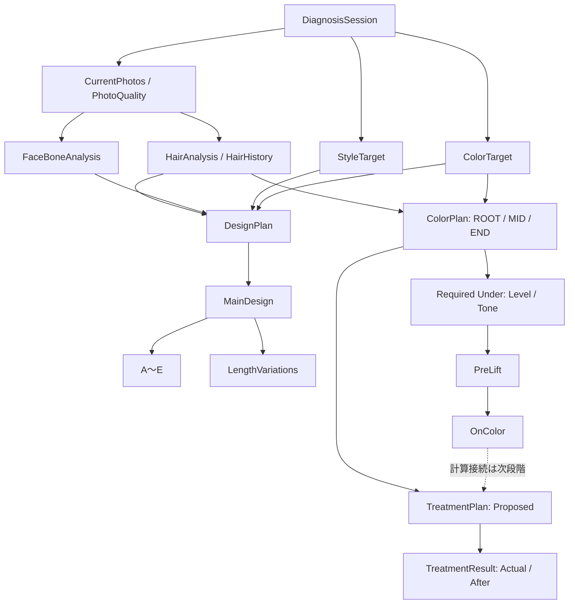

# PHASE_1_IMPLEMENTATION_REPORT

COLOR FUTURE AI / HAIR DESIGN LAB — Common Data Architecture & Feature State Foundation

基準日: 2026-10-04。正式仕様: MASTER SPECIFICATION v1.0。基準監査: MASTER_SPEC_v1.0_IMPLEMENTATION_GAP_REPORT。

**Phase 1の共通データ基盤を実装しました。** 1件のDiagnosisSessionに写真、診断、STYLE、COLOR、デザイン、カラー計画、提案、実施結果を紐づけています。既存カルテと同じID・保存版・保存先を利用します。既存FIOLE資料とgenerate APIは変更していません。Phase 2の実装は開始していません。

## 1. 変更したファイル

Phase 1開始前のファイル内容と比較した差分です。以前から存在する未コミット変更と、今回の変更を混同していません。

|区分|ファイル|内容|
|---|---|---|
|追加|`src/lib/session-model.ts`|共通型、enum、セッション生成、未知値、実効毛髪値の取得|
|追加|`src/lib/session-adapter.ts`|旧Journeyの追加変換、差分同期、移行定義、画像参照の解決|
|追加|`src/lib/session-validation.ts`|ID参照、出所、親子関係、版、原本の変更禁止を検証|
|追加|`src/lib/diagnosis-session-store.ts`|既存保存先を共有する共通モデル用の保存インターフェース|
|追加|`src/lib/feature-registry.ts`|32機能の状態、動作範囲、未接続部分、状態スナップショット|
|追加|`src/lib/analysis-contract.ts`|将来の毛髪・骨格解析へ渡す入力形式。解析処理は未接続|
|追加|`src/lib/generation-contract.ts`|将来の画像生成へ本人・STYLE・COLOR・診断・設計を渡す形式|
|追加|`src/components/feature-state-panel.tsx`|「出典／データ」内の折りたたみ検証画面|
|追加|`tests/session-foundation.test.mjs`|共通基盤の23テスト|
|追加|`scripts/session-foundation-ui.mjs`|ブラウザと実IndexedDBによる旧カルテ互換・保存テスト|
|追加|`docs/specs/COLOR_FUTURE_AI_MASTER_SPEC_v1.0.md`|正式マスター本文の保存|
|追加|`docs/specs/MASTER_SPEC_v1.0_IMPLEMENTATION_GAP_REPORT.md`|Phase 1開始前の監査結果の保存|
|追加|`docs/PHASE_1_IMPLEMENTATION_REPORT.md`|本報告|
|変更|`src/lib/journey.ts`|DiagnosisSessionを既存Journeyへ追加し、診断開始時に共通IDを確保|
|変更|`src/lib/journey-store.ts`|同じ端末／メモリ保存先へ共通モデルを保存。版競合と原本保護を検証|
|変更|`src/components/counseling-studio.tsx`|画面の変更・読込・保存にadapterを接続。サンプルには新規セッションIDを採番|
|変更|`app/fiole/counseling.css`|検証パネルだけの表示とスタイルを追加|
|変更|`AGENTS.md`|正式マスターの所在とPhase 1の承認範囲、状態区分を記録|
|変更|`README.md`|Phase 1の状態、確認画面、検証コマンドを追加|
|変更|`.gitignore`|追加ブラウザテストの出力先を除外|

削除した既存ファイル: **0件**。既存テストファイルも変更していません。

## 2. 新規データモデル

|モデル|主要データ・分離方法|
|---|---|
|DiagnosisSession|id、customerId、createdAt、updatedAt、status、appVersion、specVersion、schemaVersion、dataSchemaVersion、revision|
|CurrentPhoto / PhotoQuality|FRONT・RIGHT・LEFT・BACK、元画像参照、撮影日時、CAMERA/LIBRARY、GOOD/CAUTION/NG、スコア、個別品質フラグ、校正拡張枠|
|HairAnalysis|aiEstimateとstylistCorrectionを独立した履歴として保持。ROOT/MID/ENDをそれぞれ保持|
|HairZoneValues|baseLevel、underLevel、underTone、lightness/hue/chroma、赤/橙/黄残留、人工色素、天然メラニン、damage、porosity、hairThickness、grayPercentage、色ムラ、色表現|
|HairHistory|COLOR、DARK_COLOR、BLACK_DYE、BLEACH、LIGHTENER、STRAIGHTENING、ACID_STRAIGHTENING、PERM、OTHER。日付・部位・回数・メモ・出所|
|FaceBoneAnalysis|AI原本と美容師補正。顔幅/長さ、額、上/中/下顔面、頬骨、顎、眉、目、生え際、左右バランス。頭頂・ハチ・側頭・後頭・頭幅/奥行の拡張枠|
|StyleTarget|STYLE専用画像、長さ、シルエット、レイヤー、ウェイト、ボリューム、毛先、分け目、毛流れ、スタイリング、前髪、顔周り|
|ColorTarget|COLOR専用画像、元色、調整値、調整中の値、確定時刻、調整後画像、確定履歴、部位・ハイライト・ローライトの拡張枠|
|ColorRepresentation|display: RGB/HEX、perceptual: Lab/LChと校正状態、manufacturerVector: FIOLEの資料固有軸を別レイヤーで保持|
|DesignPlan|毛髪/骨格/STYLE/COLORのID参照、MainDesign、A〜E、長さ5種、採用案|
|MainDesign|designId、parentSessionId、本人写真、STYLE/COLOR条件、骨格分析参照、生成画像、ジョブ状態、生成メタデータ|
|BangFaceFrameDesign|A〜E、名前、視覚効果、10項目の前髪/顔周りパラメータ、根拠、骨格値を実際に使用したか、美容師補正、parentDesignId|
|LengthVariation|MINUS_10、MINUS_5、BASE、PLUS_5、PLUS_10。MainDesignの親ID、生成状態、生成画像|
|ColorPlan|ROOT/MID/END別の現在色、目標色、仕上がりLv、必要アンダーLv/トーン、ルート、予測UNDER、PRE-LIFT、ON COLOR|
|PreLift / OnColor|1剤の薬剤・染料方向・設定Lv・アルカリ/リフト/デポジット特性と、2剤/OXの濃度・量・混合比・負担を分離。部位、時間、予測結果|
|TreatmentPlan|提案処方、採用した提案ID、予定OX、予定時間。過去の提案を残して再試算可能|
|TreatmentResult|Actual、PRE-LIFT/ON COLOR実施履歴、実到達UNDER、After写真、結果評価。提案内容を上書きしない|
|SourcedValue|value、sourceType、sourceId/sourceIds、confidence、createdAt、method|

`porosity`は互換性のため内部キーとして保持し、既存の画面名「薬剤の吸い込みやすさ」を維持しています。

COLORの主要調整値はlightness、saturation、redness、yellowness、mutedness、beige、transparency。ash、olive、violetは追加用のnull枠です。表示用スライダー値と正規化値を確定履歴で分けて保持します。

未知値はnullです。baseLevelとunderLevel、仕上がりLvと必要アンダーLv、メラニンと人工染料を同じ数値へ潰していません。画像の色値を薬剤の実発色Labや化学的染料濃度へ置き換えていません。

### 接続図

線は所有関係・同じセッション内の参照を示します。AI解析や逆算エンジンが実稼働していることを示す図ではありません。

### 版と参照

|項目|今回の値・扱い|
|---|---|
|specVersion|`1.0`|
|schemaVersion / dataSchemaVersion|`diagnosis-session-v1`|
|既存Journey.schemaVersion|`color-journey-v1`のまま|
|appVersion|共通モデル内は`0.1.0-phase.1`。既存package.jsonのversionは変更なし|
|feature registry version|`phase1-features-v1`|
|adapter version|`journey-session-adapter-v1`|
|record ID|DiagnosisSession.idと保存済みJourney.idが同じ|
|revision|共通モデルのrevisionとJourney.versionが同じ。保存ごとに新しい版を追加|

## 3. 既存モデルとの互換方法

既存Journeyを残し、`Journey.diagnosisSession`に共通モデルを追加しました。現在のUIは従来のJourney操作を維持し、変更を共通モデルへ同期します。新しいモジュールは`diagnosisSessionStore`経由で共通モデルを読み書きできます。

2つの独立したデータベースは作っていません。端末保存名`hair-mirror-color-journey-v1`、IndexedDBのversion 1、`records`と`revisions`の構造を維持しています。メモリ用保存も同じ版管理です。

元画像のバイト列は従来の写真レコードに残します。共通モデルは`journey-image:ID`、`journey-original:ID`等の役割別参照を持ち、巨大な画像データを二重に複製しません。`resolveSessionImage`が元画像と表示画像を明確に分けて解決します。元画像が存在しない場合、縮小画像を元画像として返しません。

## 4. migration / adapter

1. 旧形式を読み込むと、メモリ内で共通モデルを追加します。この読込だけで端末の旧保存版を書き換えません。
2. 利用者が保存すると、同じカルテIDの新しいrevisionに共通モデルを追加します。古いrevisionは保持します。
3. 各モジュールに旧入力のbindingを記録します。旧入力が変化していない場合、共通モデルに追加された新しい測定枠・美容師補正・STYLE条件等を消しません。
4. 診断原本・補正・COLOR確定・生成画像・実施工程の保存済み履歴は変更/削除を拒否します。補正は原本への別レコードとして追記します。
5. 手入力値をA→B→Aと戻した場合も新しい補正判断を追加します。「不明へ戻す」場合は明示的なnull補正を残します。
6. 保存版が古い画面からの上書きを拒否します。旧UIと新しい保存インターフェースは同じ版競合チェックを使います。
7. 将来の未対応schemaVersionは読み替えず、原データを保持したままエラーにします。v1.1以降の変換処理はまだ実装していません。

旧`side`写真は右/左を断定せずdirection=null、legacyDirection=`side`で残します。旧履歴の`dark`も黒染め/暗染めを推測で分類せず、OTHERと曖昧さの説明を保持します。撮影情報がない旧写真にCAMERA/LIBRARY、撮影日時、GOOD判定を補作していません。

旧COLORの`image_preview_estimate`という値は旧データ内では変更しません。新モデルでは実処理に合わせて`STYLIST_CORRECTED / manual_hair_image_sample_uncalibrated`と記録し、手動採色をAI解析済みとして扱いません。

旧単枚画像生成履歴は`LEGACY_SINGLE`として保存します。MAIN DESIGNやA〜Eの生成結果に偽装していません。

## 5. FeatureRegistryとUI

32機能をコード上で管理しています。状態はREAL、ESTIMATE、MOCK、PARTIAL、UNIMPLEMENTEDの5種類。各定義に動作範囲と未接続部分があります。セッションには保存時の機能状態のスナップショットを持たせます。読込だけでは保存済みappVersionや状態スナップショットを変更せず、新しい保存版に現在の版・機能状態を記録します。

SourceTypeは機能状態と別概念です。MANUFACTURER、REFERENCE、EMPIRICAL、AI_ESTIMATE、STYLIST_CORRECTED、MOCKの6種類を定義しました。メーカー資料の値を経験補正で上書きしません。

画面確認: `/fiole/demo` → 左下「出典 / データ」→「開発・検証 · 機能状態と共通データ」。初期状態は閉じています。ホームの4STEP、CTA、写真カード、Before/Afterは維持しました。

MAINの親IDやA〜Eの保存枠がREALであることと、本人実写の5画像が生成済みであることは別に表示します。

## 6. REAL / ESTIMATE / MOCK / PARTIAL / UNIMPLEMENTED

|状態|件数|機能と確認範囲|
|---|---:|---|
|REAL|14|共通データ基盤、旧データadapter、同一カルテ保存、美容師毛髪補正、STYLE、COLOR、手動マスク内ライブ補正、ターゲット確定、色空間/色差演算、FIOLEライブラリ、MAIN/子デザインの保存構造、前髪の美容師補正、生成入力契約、提案/実施記録|
|ESTIMATE|0|この環境で接続・動作を確認した実AI診断はありません。AI_ESTIMATEの保存型は用意しています|
|MOCK|3|固定の毛髪診断、固定の顔/骨格比率、固定テンプレートの前髪/顔周りA〜E|
|PARTIAL|4|4方向撮影、簡易撮影品質、FIOLE候補検索、既存HAIR MIRROR単枚生成|
|UNIMPLEMENTED|11|自動髪抽出、AIデザイン設計、本人実写A〜E生成、5案一括生成、長さ5種の実写生成、必要アンダー逆算、ルート自動判定、PRE-LIFT予測、ON COLOR発色計算、FIOLE最適配合、実績補正モデル|

PARTIALの境界:

- 撮影: カメラ/ライブラリ/ガイド/採用の既存実装は保持。iPhone/iPad実機、距離の実測は未検証です。
- 品質: 画素ベースの簡易露出・逆光・鮮鋭度・ガイド領域による位置チェック。髪だけの品質評価、色かぶり等の高度判定、校正は未実装です。
- FIOLE候補: 既存の図上構成による候補順位とg換算は動作。配合比率はMOCKで、実発色・リフトに基づく探索ではありません。
- 単枚生成: 既存APIと役割別送信・履歴は保持。この環境のAPIキー未設定により有料の実生成は未検証。新しい共通契約から正式MAIN/子生成への接続は未実装です。

HairAnalysisとFaceBoneAnalysisにはMOCK状態と各値のMOCK出所を保持します。既存A〜Eの骨格根拠参照には`valuesWereUsed: false`を記録しています。画面に骨格IDがあるだけで、骨格値から生成したとは扱いません。

## 7. 追加テスト

`tests/session-foundation.test.mjs`に23件を追加しました。

- セッション作成、spec/schema/app版、未知値null、モジュールID参照。
- ROOT/MID/ENDの保存、AI原本の不変性、美容師補正の独立保存。
- ネイティブ骨格補正・追加STYLE条件・履歴回数の互換保存。
- STYLE/COLOR画像の役割分離と、STYLE変更でCOLOR/レシピ入力が変化しないこと。
- 髪だけCOLOR確定、元色/調整色/スライダー/プレビュー/マスク参照/時刻/未校正状態。
- MAIN→A〜Eと長さ5種の親ID。画像なしの生成完了を拒否。
- FeatureStateとSourceType、0とnull、MOCKの偽AI出所の拒否。
- 旧カルテ・元画像・独自追加項目の保持。画像バイト列の重複を回避。
- 旧side方向、欠損撮影情報、曖昧な暗染め履歴の保持。
- 未対応の将来版と別セッション参照、同時更新、保存済み原本の改変を拒否。
- 提案とActualを分離し、未確認の提案コピーをEMPIRICALとして扱わないこと。
- PRE-LIFT/ON COLOR実績と予測を分離し、同一部位の実到達UNDERをON COLORへ参照。
- STYLE_ONLY/COLOR_ONLY/STYLE_COLORの生成入力と本人維持の役割定義。
- 旧単枚生成を親子生成に偽装しないこと。
- A→B→A→不明の補正履歴。旧提案を再試算後もActualの出典として保持。
- 将来の解析入力と元画像の解決、ネイティブSTYLE条件の生成入力への参照。
- 読込で過去のappVersion/機能状態を上書きせず、新しい保存版だけに現在の版を記録すること。

追加のブラウザテストは、端末の実IndexedDBへ旧形式のfixtureを投入し、旧版を変更せずに読込→ホームの補正→第2版保存→再読込を実行します。テスト用データであり、利用者の実カルテを初期化/変更していません。

## 8. テスト結果

|検証|結果|
|---|---|
|`npm test`|**63 / 63 PASS**。既存40件＋追加23件。失敗/skipとも0|
|`scripts/session-foundation-ui.mjs`|**PASS**。Chromium 153、1194×834と1024×768、タッチ対応画角|
|実IndexedDB|旧revisionを完全保持し、同じIDへ共通モデルを含む新revisionを追加。補正値は再読込後も一致|
|検証UI|初期折りたたみ、REAL/MOCK/PARTIAL/UNIMPLEMENTEDのラベル、同じセッションIDを確認|
|画像生成POST|0回。既存の利用可否GET確認は6回。外部の画像生成処理は実行していません|
|ブラウザ未処理エラー|0件|
|既存データ保護|FIOLE JSON、Web出典JSON、写真サンプルJSON、UI基準画像JSON、generate API、画像生成clientのSHA-256がPhase 1前後で一致|

FIOLEは73資料項目・149色番・15色素軸を保持しました。資料固有の構成軸をRGBや実際の化学濃度へ変換していません。

## 9. 型検査・本番ビルド

- `npm run typecheck`: **PASS**、終了コード0。
- `npm run build`: **PASS**。Next.js 16.3.8のTypeScript検査、ページ生成、本番ビルドが完了。
- `/`、`/diagram`、`/fiole`、`/fiole/demo`、`/fiole/records`、既存`/api/generate`を保持。
- 検証環境: Node.js 24.19.0、TypeScript 5.9.3、Chromium 153.0.8010.0。

## 10. 未解決問題・今回の限界

1. iPad/iPhoneの実機Safari、実カメラ、端末間の互換保存は未検証です。ブラウザの画角検証を実機検証とは表記していません。ヘッドレス環境の日本語フォントが不足しているため、取得スクリーンショットは実機の文字描画の証明に使っていません。
2. 新しい解析/生成入力はインターフェースのみです。実AI解析、骨格に基づく設計、親子実写生成、逆算・発色・配合計算、学習は接続していません。
3. 共通モデルに新規追加した骨格補正やSTYLEの詳細項目は保存可能ですが、従来のUIがすべての新項目を表示・編集するわけではありません。今後は共通モデルのselectorを段階的にUIへ接続します。
4. 解析用元画像がない旧写真は、その欠損を保持します。グレーカード/カラーチャート校正、ICC/EXIF解釈、自動髪領域抽出は未実装です。
5. 保存済みAfter写真を置き換えた場合、古い画像バイト列は旧revisionに残ります。過去After参照を最新Journeyだけで解決することはできません。過去revisionの取得用インターフェースや独立画像ストレージは次段階の課題です。
6. クラウド同期、全履歴の一括移行/書出し、未対応の将来schemaへのmigrationは未実装です。空のセッション単独保存は従来のカルテ保存条件の対象外です。
7. 新セッションのcustomerIdはnullのまま利用できます。顧客管理・ログイン・課金は追加していません。

## 11. Phase 1完了条件とPhase 2へ進める状態

|完了条件|結果|
|---|---|
|1件のDiagnosisSessionで一元管理|PASS — 同じカルテIDに全モジュールを保持|
|CURRENT→診断→STYLE/COLOR→DesignPlan→ColorPlan→TreatmentResult参照|PASS — 同じセッションのモデル・ID参照として接続。AI/計算の実処理とは区別|
|STYLEとCOLOR独立|PASS|
|AI原本と美容師補正独立|PASS|
|MAINとA〜Eの親子構造|PASS — 生成画像は未実装|
|提案と実施処方独立|PASS|
|5種類のFeatureStateをコードで管理|PASS|
|既存データを破壊しない|PASS — 旧保存版の不変性と保護対象ファイルの一致を検証|
|テスト・型検査|PASS|

**共通基盤としてPhase 2の接続作業へ進める状態です。** 施術判断に使用できるAI精度・薬剤計算が完成した状態ではありません。この報告の確認と次フェーズの指定を待ちます。

## 12. Phase 2で最初に接続すべき機能

依存関係順の提案です。今回の実装には含めていません。

1. **CURRENT PHOTO → 解析用入力の実接続**。新しい解析入力契約と元画像resolverを、既存撮影/ライブラリ入力へ使用。iPad/iPhoneで4方向、元画像、品質フラグ、再読込を実機検証します。
2. **毛髪/骨格解析provider → 共通モデル**。髪マスク/ランドマーク等の実処理を接続し、可能な値だけをAI_ESTIMATEで保存。根拠のないダメージ/内部毛髪特性はnull/美容師確認を維持します。既存UIのselectorも同じ原本・補正を参照させます。
3. **FaceBoneAnalysis → DesignPlan**。実測/推定された比率を使うルールまたはAI設計、A〜Eの根拠キー、選択後の美容師修正を接続します。
4. **共通生成契約 → 既存HAIR MIRROR**。最初に正式MAINを接続し、本人維持・STYLEの形・調整済みCOLORの色を検証。その後にMAIN親からA〜E、再試行、長さ案へ広げます。
5. **メーカー資料 → ColorPlanの校正データ**。FIOLEの正式OX、混合比、アルカリ/リフト/デポジット特性、ライトナー/ブリーチ説明書を収集。未知値を埋める根拠を整えた後に必要アンダー・ルート・ON COLORの計算を実装します。
6. **実施工程/After → 評価データ**。撮影品質、校正、実到達UNDER、実際の処方を紐づけ、教師データとしての採用条件と評価方法を定義します。学習モデルの実装はその後です。

## 配布と再確認

最新版ZIPにはこの報告、正式マスター、監査結果、app/src/public/tests/scripts、package-lock、`.env.example`を含めます。node_modules、`.next`、秘密の環境変数、過去の配布ZIP、テスト画像出力は含めません。Next.jsの起動に必要なソース一式です。

ZIPは標準の非暗号化ZIPとして作成し、中央ディレクトリ・CRC・実展開と収録ファイルのSHA-256を検証済みです。iPad「ファイル」アプリでの実機解凍は未検証です。

Node環境で展開した`hair-style-ai`内から`npm ci`、`npm test`、`npm run typecheck`、`npm run build`を実行できます。画面は`npm run dev`で起動し、`http://localhost:3000/fiole/demo`から確認できます。共通基盤とMOCK画面の確認にはAPIキーは不要です。既存の実画像生成を利用する場合の設定は`.env.example`と従来マニュアルを参照してください。

本Phase 1ではデプロイ・GitHubへのpush・Phase 2への着手を行っていません。
