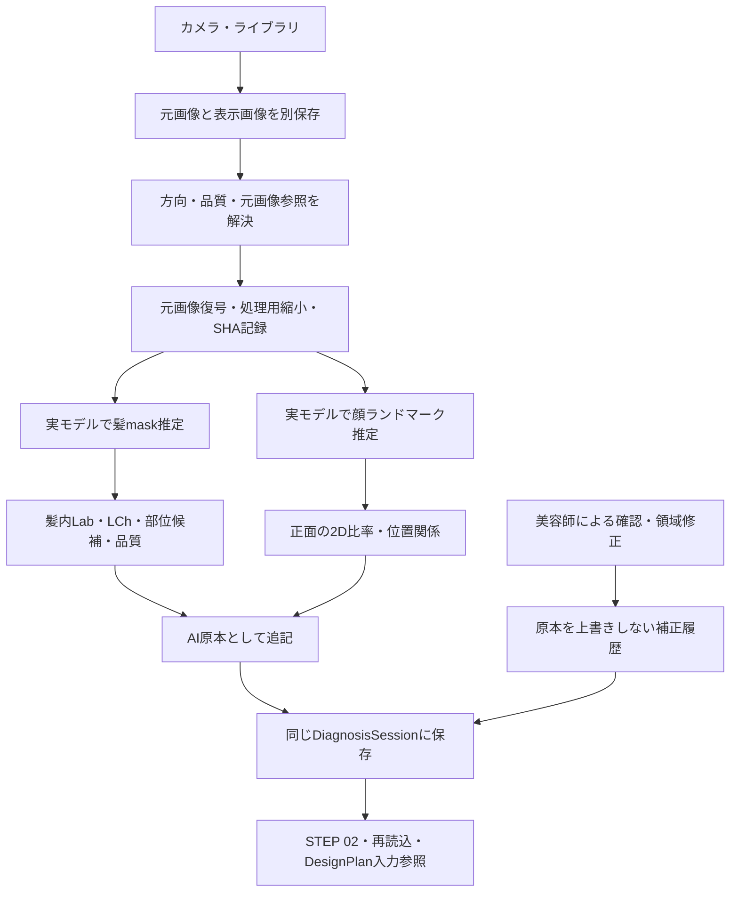

# PHASE_2_IMPLEMENTATION_REPORT

COLOR FUTURE AI / HAIR DESIGN LAB · 2026-10-04

正式基準：MASTER SPECIFICATION v1.0、MASTER SPEC v1.0 IMPLEMENTATION GAP REPORT、PHASE_1_IMPLEMENTATION_REPORT。

## 結果

**現在写真の元画像 → 実モデルの髪領域／顔ランドマーク → 画像上の色・位置関係 → 同じDiagnosisSessionへの保存**を接続しました。STEP 02から解析・確認・美容師修正・保存・再読込できます。

実モデルをChromiumのWorkerとメインスレッドの両経路で動かして確認済みです。83件のテスト、型検査、クリーンな本番ビルドがPASS。iPad／iPhone実機Safariは未検証です。髪領域・顔表面位置の推定精度、撮影品質の閾値、実際の毛髪部位との対応は未校正のためPARTIALとして残します。

Phase 3には進んでいません。MAIN DESIGN、本人実写A〜E、骨格からのデザイン設計、必要アンダーの本計算、FIOLE配合最適化は今回実装していません。

## 1. 使用したprovider／model

| 層 | 実装／固定版 | 実行と状態 |
|---|---|---|
| Provider | MediaPipe Tasks Vision **1.0.1** | ブラウザ内の実推論。OpenAI APIキー不要 |
| Hair model | `hair_segmenter/float32/1` | Confidence maskから画像固有の髪領域を推定。PARTIAL |
| Face model | `face_landmarker/float16/1` | 最大2人を検出し、1人のみを採用。顔表面478点。ESTIMATE |
| 実行 | CPU／WASM、通常はWorker | OffscreenCanvasが使えない場合のメインスレッド経路も検証 |
| 配信 | `public/analysis`にSDK・WASM・modelを同梱 | 同じWebサイトから取得。解析のための写真送信は不要 |

公式モデルを固定URLから取得し、SDK・モデル・WASMのSHA-256と版を`public/analysis/asset-manifest.json`に保存しました。Apache-2.0ライセンスと`NOTICE.md`を同梱しています。

SDK 1.0.1の既定の利用状況ログについては、**logger生成だけを無効化した限定的なローカルパッチ**を採用しました。モデル・推論処理・ブラウザの通信APIは変更していません。`scripts/prepare-analysis-assets.mjs`が上流版・SHA・置換箇所数を確認して再現します。Workerと互換経路は同じパッチ済みSDKを使用します。検証中の外部POST／PUT、画像生成POSTはいずれも0件でした。

モデルの適用範囲にも制約があります。Hair Segmenterは正面セルフィー用途を中心とするモデルで、後頭部・真横・細い毛・遮蔽・極端な照明に対する精度は今回検証していません。Face Landmarkerは顔表面の位置推定で、頭蓋骨や実際の生え際を測るモデルではありません。

## 2. REAL／ESTIMATE／PARTIAL／MOCK／未実装

機能状態とデータの出所を区別しています。実モデルが動作することと、その推定値が実測・メーカー値であることは同じではありません。

| 状態 | 今回確認できたこと | 境界 |
|---|---|---|
| **REAL** | 4方向の元画像と表示画像の分離・解析入力、原画像SHA、保存／再読込、AI原本と美容師修正の分離、髪領域の手動修正、色空間の演算 | 解析・保存パイプラインの動作 |
| **ESTIMATE／AI_ESTIMATE** | 実モデルの髪mask・顔ランドマーク、それを使った画像上の色と位置比率 | 画像推定。物理的な髪色・骨格の実測ではない |
| **PARTIAL** | 毛髪診断、顔・骨格分析、4方向撮影、髪領域抽出、撮影品質 | 未取得項目、閾値・精度の未校正、iOS実機未検証を含む |
| **MOCK** | 以前の固定毛髪／顔診断・前髪A〜E案 | 既存機能を削除せず、明記した折りたたみ内に保持 |
| **UNIMPLEMENTED** | MAINへの正式接続、本人実写A〜E一括生成、骨格→5案の本設計、Required Under／Lift Route／PRE-LIFT／ON COLORの本計算、FIOLE最適化、実績学習 | データ参照・既存デモの保持のみ |

既存の単枚HAIR MIRROR APIと画像生成契約は変更していません。旧単枚生成はPARTIALのままです。今回の検証では画像生成を呼び出していません。

## 3. 元画像の接続と保存

`analysis-contract`の`resolveAnalysisInput()`が、`resolveSessionImage()`を使い、各FRONT／RIGHT／LEFT／BACKの元画像・表示用画像・方向・CAMERA／LIBRARY・品質を解決します。

- ライブラリ入力は元ファイルのdata URLを保持します。表示用の縮小・切り抜き画像とは別です。
- カメラ入力の元画像は、ブラウザの映像フレームから採取したJPEGです。端末センサーのRAW画像ではありません。この表現種別も保持します。
- 解析時は元画像を復号し、縦横比を維持して長辺最大1024pxの処理バッファを作成します。原画像の寸法・SHA-256・処理寸法・EXIF方向・未校正状態を記録し、処理バッファで元画像を置き換えません。
- 全体の色平均を使わず、実モデルの髪mask内の画素だけを色解析に使用します。美肌加工・カラーフィルターは適用しません。
- 元画像のない旧縮小サンプルは解析対象外とし、理由を表示します。表示画像を元画像として扱うフォールバックはありません。
- 写真が差し替えられると古い解析は現在値として無効になります。解析run・AI原本・美容師修正は残し、解析に使用済みの元写真は`analysisPhotoArchive`に保全します。未保存の相談でも保全します。
- 処理中の写真変更、別セッションの結果、同じrunの二重登録を拒否します。検出／モデル取得に失敗してもMOCK値は代入しません。

最後のDesignPlanは**入力参照の保持**までです。取得した骨格値をA〜Eの設計・画像生成にまだ使用しません。

## 4. 取得できる毛髪値

| 項目 | 保存と意味 |
|---|---|
| Hair region／mask | 画像固有の実推論maskを`BINARY_RLE_V1`で保存。閾値0.8、選択画素のモデルconfidence、bounds、モデル版・画像IDを保持 |
| Lightness | 髪mask内の画像Lab **L\***。サロンのLvへ換算しない |
| Hue／Chroma | 画像LabからLChのh／Cを算出 |
| RGB／HEX | 代表Labから表示用スウォッチへ変換。メーカー染料ベクトルとは別 |
| 色ムラ | 選択画素のLabばらつき。照明・反射・ハイライトも含む。人工色素ムラとは断定しない |
| ROOT／MID／END | 髪maskの画像上の縦方向候補区切り。各領域の色・画素数を個別保存 |
| 方向差 | 各方向の結果を個別保存。異なる方向・照明を平均して単一の擬似測定値にしない |

色の代表値は透明画素・白黒クリップ画素を除外し、明度の両端10%を除いたLab平均です。採用画素が32未満なら`null`。未校正のsRGB／D65／2度視野として記録します。モデルconfidenceは診断精度の保証や色の正確さを表す数値ではありません。

ROOT／MID／ENDは毛流れや実際の染め分け境界を認識した値ではありません。「詳細を見る」で美容師が髪を塗る／消す操作と上下の区切りを修正できます。変更mask・部位色・確認者・時刻を別履歴に保存し、AI maskとAI色は上書きしません。代表色は正面の取得結果を優先し、未取得なら利用可能な別方向を採用して、その画像IDを残します。

**今回は取得しない値：** Base Level、Under Level／Tone、正確な赤／橙／黄残留量、天然メラニン量、人工色素量、ダメージ、内部損傷、薬剤の吸い込みやすさ、髪の物理的な太さ、白髪率。AI原本では`null`です。特に白髪と強い反射・明るい色の毛を今回のmodelだけで信頼性高く分離できないため、白髪率を補完しません。

## 5. 取得できる顔・骨格値

FRONTの顔表面ランドマークを画像の縦横寸法で補正し、以下を取得します。

| 項目 | 画像上の定義／限界 |
|---|---|
| `faceWidthRatio` | 左右の顔表面点234–454間距離／画像幅 |
| `faceHeightRatio` | 顔表面点10–152間距離／画像高さ。生え際からの顔長ではない |
| `faceHeightWidthRatio` | 顔表面の縦距離／横距離。画素縦横比を補正 |
| `cheekbonePosition`／`cheekboneWidthRatio` | 頬付近の表面点の位置／幅。骨の実測ではない |
| `jawWidthRatio` | 顎周辺の表面点172–397間距離／顔幅 |
| `chinPosition` | 顔表面の縦軸上の顎位置。顎を基準終点とするため通常1。評価点ではない |
| `browPosition`／`eyePosition` | 表面縦軸に対する眉・目の位置 |
| `browEyeDistance` | 眉・目間の画像上の距離／顔表面縦距離 |
| `midfaceRatio` | 眉付近〜鼻底の表面縦軸比。解剖学的な上中下3等分ではない |
| `lowerFaceRatio` | 鼻底〜顎の表面縦軸比 |
| `additionalMeasurements.nosePosition` | 鼻先の表面縦軸位置 |

正面で取得条件を満たす場合、共通metricsの12項目と鼻位置を保存します。入力画像・ランドマーク番号・算出方法を追跡できます。RIGHT／LEFTでは検出可能なランドマークを保持しますが、正面用の幅・比率を流用しません。BACKは顔解析対象外です。複数人物がいる場合、顔ランドマークを混ぜず未採用にします。

**未取得で`null`：** 額高さ／幅、上顔面、生え際、左右の物理バランス、頭頂、ハチ、側頭部、後頭部、頭幅／奥行き、真の骨格寸法。点10を生え際と同一視しません。隠れた頭部形状を補完しません。ランドマークのzはモデルの相対座標としてraw出力内に保存するだけで、物理3D骨格や実寸へ変換しません。

取得値は`FaceBoneAnalysis.aiEstimate`内の`sourceType: AI_ESTIMATE`。美容師確認は`stylistCorrection`へ追記します。今回、顔そのものを変形する処理・顔型カテゴリの絶対判定はありません。

## 6. 撮影品質

| 判定 | 今回の処理 | 状態／未取得部分 |
|---|---|---|
| 露出・白飛び・黒つぶれ | 実モデルの髪mask内の輝度・クリップ率 | 実画素計算。閾値は未校正の簡易スクリーニング |
| 逆光 | 髪の明るさと画面端背景の差 | 簡易推定。背景や髪色による誤判定あり |
| Blur | 髪mask内のLaplacian分散・コントラスト | 縮小画像の鮮鋭度プロキシ。低模様では未判定 |
| Motion blur | カメラ入力に実際の時間差判定情報があれば保持 | 単一写真から手ブレとピンぼけを区別しない |
| Positioning | 髪mask／顔ランドマークの画像上の中心・幅 | 移動方向の案内まで。物理距離の測定なし |
| Framing | 髪maskや顔ランドマークの画像端接触 | 見切れの可能性。髪全体が写っている保証なし |
| 光のムラ | 左右の髪輝度差 | 照明とデザインカラーの差を区別できないことを表示 |
| 強い反射 | 明るい画素比・コントラスト | 反射または明るい毛の可能性として表示 |
| Color cast | 中性基準色がないため未判定 | `NOT_ASSESSED` |
| レンズ汚れ・曇り | 原因を断定できないため未判定 | `NOT_ASSESSED` |

GOOD／CAUTION／NG、個別flag、metrics、method、algorithmVersion、評価時刻を保存します。0〜100のscoreはこの未校正ルールの補助値で、髪領域がない場合は`null`です。警告は優先度の高い最大2件。CAUTION／NGでも美容師の採用を禁止せず、既存のoverrideを保持します。品質はPARTIALであり「カラー診断に必要な条件をすべて実測した」という表示はしません。

## 7. UI

新しいトップレベルSTEPや管理画面は増やしていません。アイボリー・ホワイト・ゴールドの4STEP UIを保持しました。

1. **現在写真撮影**：既存の4方向カメラ／ライブラリから入力。
2. **AI診断を確認**：実解析ボタン、部位選択、画像の明るさ・色・ばらつき。アンダー・白髪率・薬剤の吸い込みやすさは取得しない場合「美容師確認」。
3. **FACE / BONE**：取得した場合は「顔の位置関係を取得しました」。顔表面の推定と2D関係であることを添記。
4. **詳細を見る**：AI原本／美容師確認、4方向のmask、塗る・消す・区切り修正、実際に取得した顔比率、品質、元画像／処理サイズ。
5. **以前のDEMO診断／前髪案**：折りたたみに残しMOCKと明記。実解析からA〜E設計へ自動接続しない。

ホームの診断バーもactiveな実解析原本／美容師確認を参照します。未取得の値を固定AI診断値に見せません。既存DEMOを明示的に使用した場合は実解析のactive参照を解除し、元の解析履歴は保持します。

## 8. 共通モデル・互換性

新規／追加：`PhotoAnalysisState`、`PhotoAnalysisRun`、`AnalysisPhotoResult`、`HairRegion`、`BinaryMask`、`ObservedHairZone`、`RegionCorrection`、`analysisPhotoArchive`。

| 版 | 値 |
|---|---|
| specVersion | `1.0` |
| appVersion | `0.1.0-phase.2` |
| 外側のdataSchemaVersion | `diagnosis-session-v1`を維持。旧データ互換の追加フィールド |
| 追加解析schemaVersion | `photo-analysis-v1` |
| FeatureRegistry | `phase2-features-v1` |

`DiagnosisSession.photoAnalysis`は後方互換のoptionalフィールドです。旧Journeyを残す既存adapterの読み込み・保存経路を拡張し、既存カルテや原本の一括置換・削除を行いません。新しい実解析のactive IDを旧固定診断への変換で上書きしないようprojectionを維持します。AI runと領域修正は追記専用で、保存時に原本改変を検出します。

`DesignPlan.inputs`は実際のHair／Face estimate IDを参照します。`ColorPlan.currentColor`には部位ごとの画像観測色を保持しますが、自動Required Under／Lift Route／PRE-LIFT／ON COLOR計算には進みません。STYLE／COLOR参考と調整・提案／実使用・生成履歴は変更しません。

## 9. 変更したファイル

### 既存ファイルへの差分

| ファイル | 差分 |
|---|---|
| `src/lib/analysis-contract.ts` | 元画像・表示画像・撮影メタデータの共通入力解決 |
| `src/lib/session-model.ts` | optional解析state、アプリ版、初期状態 |
| `src/lib/session-adapter.ts` | 実解析active参照・品質・観測色のprojection、元画像archive参照 |
| `src/lib/session-validation.ts` | 新解析形式・追記履歴の検証 |
| `src/lib/journey.ts` | 原画像archiveと原画像入力の検証 |
| `src/lib/journey-store.ts` | 差し替え時の原画像保全、実解析済み相談の保存 |
| `src/lib/feature-registry.ts` | 実態を反映したPhase 2状態 |
| `src/components/counseling-studio.tsx` | 実解析の開始／中止／保存、旧MOCKの階層化 |
| `src/components/reference-home.tsx` | 実解析／美容師確認のホーム表示・修正 |
| `src/components/face-design-panel.tsx` | 旧固定MOCKとSTEP 02の実解析を明確化する説明 |
| `app/fiole/counseling.css` | STEP 02・領域編集の既存ブランドに沿うスタイル |
| `package.json`／`package-lock.json` | 固定SDK依存、再現可能なprebuild準備 |
| `tests/session-foundation.test.mjs`／`scripts/session-foundation-ui.mjs` | Registryの新状態に対応。既存の互換検証は保持 |
| `AGENTS.md`／`README.md` | 正式なPhase 2範囲・操作・検証・停止条件 |

### 新規ファイル

- `src/lib/photo-analysis-types.ts`
- `src/lib/photo-analysis-math.ts`
- `src/lib/photo-analysis-provider.ts`
- `src/lib/photo-analysis-pipeline.ts`
- `src/lib/photo-analysis-validation.ts`
- `src/lib/segmented-photo-quality.ts`
- `src/lib/analysis-photo-archive.ts`
- `src/components/photo-analysis-panel.tsx`
- `public/analysis/worker.js`、SDK、WASM 4ファイル、モデル2ファイル、manifest、license、NOTICE
- `scripts/prepare-analysis-assets.mjs`
- `scripts/photo-analysis-ui.mjs`
- `tests/photo-analysis.test.mjs`
- 本報告書、`docs/validation/phase2`の検証結果と画面

開始時の169ファイルとの比較で既存ファイルの欠落は0件。FIOLEカタログ、参考画像データ、旧Phase 1報告、旧前髪ルール、旧ベース作り、COLOR確定処理、`app/api/generate/route.js`、生成クライアント／契約など12項目のSHA-256一致を確認しました。Gitの既存未コミット変更を消さず、GitHubへのpush・デプロイも行っていません。

## 10. テスト・本番ビルド

| 検証 | 結果 | 主な内容 |
|---|---|---|
| `npm test` | **83/83 PASS** | 既存63件＋新規20件 |
| `npm run typecheck` | **PASS** | TS型検査 |
| `npm run build` | **PASS** | 古い生成キャッシュを分離したクリーン本番ビルド |
| Phase 2実モデルブラウザ確認・Worker | **PASS** | Hair／Face実推論、保存、修正、再読込 |
| Phase 2実モデルブラウザ確認・メインスレッド | **PASS** | OffscreenCanvasなしの互換経路、同じSDK、外部送信0 |
| Phase 1ブラウザ回帰確認 | **PASS** | 既存保存版保持、補正、共通ID、Registry表示、旧UI |
| 既存データ／API保護 | **PASS** | 指定12項目のSHA一致、開始時ファイル欠落0 |

新規20件は、4方向元画像／表示分離、元画像なしの拒否、mask形式と異常値拒否、モデル出力のリサンプル、髪外画素の除外、未取得null、顔の縦横補正、額／生え際を推測しないこと、複数人物の分離、品質の画素処理、実解析値のAI_ESTIMATE保存、取得不能なAI毛髪値の拒否、差し替え無効化、古い／重複run拒否、原本改変拒否、失敗時にMOCKへ戻らないこと、STYLE／COLORと下流データ保持、美容師のnull解除、顔確認値の分離、未保存元画像保全、未知品質、配信SDK／モデルのhashとtelemetryパッチを検証しています。

ブラウザ確認には既存の**架空人物サンプル**を写真ファイルとして登録し、実モデルを動かしました。478点の顔ランドマーク、写真固有の髪mask、12顔比率、ROOT／MID／ENDの画像色を取得しています。固定maskや固定分析値を結果として差し込んでいません。

大きな画像の確認はサンプルを3200×4000へ拡大した処理負荷・元画像保持のテストです。実センサーの高解像度写真に対する解析精度テストではありません。4方向への入力も経路確認であり、4方向の実撮影素材による精度評価ではありません。EXIF Orientation 6を含む元JPEGのバイト保持とブラウザ回転を確認しました。

## 11. iPad／iPhoneの検証状況

| 対象 | 状況 |
|---|---|
| iPad横向き相当1194×834／1024×768 | Chromiumのタッチ画面設定で操作確認 |
| ライブラリ4方向入力 | Chromiumで実ファイル入力確認 |
| カメラ→採用→次方向→4枚確認 | Chromiumの**仮想カメラ**で動作確認。実カメラの検証ではない |
| 4枚CAMERAとして保存 | 確認済み。元フレームJPEGと方向を保持 |
| IndexedDB保存・再読込 | Chromiumで確認済み |
| EXIF回転・大きな元画像 | 上記テスト条件で確認済み |
| Safari／WebKit | **未検証** |
| iPad／iPhone実機カメラ・ライブラリ・端末回転 | **未検証** |
| HEIC・Safariの色管理・メモリ上限・カメラ中断復帰 | **未検証** |

実機確認ではHTTPSで`/fiole`を開き、カメラ許可→4方向撮影→品質警告下での採用→STEP 02解析→確認値／mask修正→保存→Safari再読込→過去カルテを開く、の順に確認してください。端末回転、カメラ切替、権限拒否、写真の差し替え、大きなJPEG／HEICも別途確認が必要です。今回、実機合格やSafari精度を主張しません。

## 12. 未解決問題と次に確認する項目

1. **実機Safari検証**：カメラ／ライブラリ、Workerと互換経路、保存容量、orientation、大きな写真。
2. **モデル適用範囲の評価**：正面・左右・後ろ、短髪／長髪、白髪／明るい毛、低照度、帽子／顔の遮蔽。今回の接続確認を精度ベンチマークとは扱わない。
3. **部位の校正**：縦方向候補を美容師が修正した履歴から、実際のROOT／MID／ENDに対応する方法を検証。
4. **色の校正**：グレーカード／カラーチャート、端末の色プロファイル、照明・WB差の補正。未校正Labを薬剤の実発色Labとして扱わない。
5. **顔情報の拡張**：額／生え際／頭部形状の別解析・入力方法と、画角・顔姿勢に対する比率の安定性。現在の取得値を物理骨格へ読み替えない。
6. **ユーザー確認後のPhase 3候補**：取得可能な顔・毛髪値とSTYLEをDesign Planningへ渡す接続から設計する。A〜E生成と画像生成・カラー本計算は別の検証段階にする。

未検証項目を除き、Phase 2の入力・実モデル処理・取得値保存・確認UI・状態管理・テストの条件は満たしています。全診断の精度完成やiOS実機対応完了ではありません。**Phase 3はユーザーの確認と次の実装範囲指定を待ちます。**

## 13. 公式出典

今回のWebリサーチは実装providerの一次資料を参照しました。メーカーの染毛・リフト定量値は追加作成していません。

- [MediaPipe Image Segmenter — Web](https://developers.google.com/edge/mediapipe/solutions/vision/image_segmenter/web_js)
- [MediaPipe Face Landmarker — Web](https://developers.google.com/edge/mediapipe/solutions/vision/face_landmarker/web_js)
- [MediaPipe Web setup](https://developers.google.com/edge/mediapipe/solutions/setup_web)
- [Hair Segmentation Model Card](https://storage.googleapis.com/mediapipe-assets/Model%20Card%20-%20Hair%20Segmentation.pdf)
- [MediaPipe Face Mesh V2 Model Card](https://storage.googleapis.com/mediapipe-assets/Model%20Card%20MediaPipe%20Face%20Mesh%20V2.pdf)
- [MediaPipe upstream TaskRunner](https://github.com/google-ai-edge/mediapipe/blob/master/mediapipe/tasks/web/core/task_runner.ts)

## 14. FeatureRegistry全体

`phase2-features-v1`：REAL 15／PARTIAL 7／ESTIMATE 1／UNIMPLEMENTED 10／MOCK 1。状態変更はコードと保存snapshotにも反映します。

| Feature ID | 状態 | 動作範囲 | 未取得／未接続 |
|---|---|---|---|
| `commonDataArchitecture` | REAL | 同一セッションID、参照・出所・版の管理 | — |
| `legacyAdapter` | REAL | 旧Journeyを残す読込・保存adapter | — |
| `sessionPersistence` | REAL | 端末／メモリで共通モデルと旧形式を同時保存 | クラウド同期・iOS実機検証 |
| `standardizedCapture` | PARTIAL | カメラ・ライブラリ・ガイド・採用UI | iPhone/iPad実機検証・距離の実測 |
| `currentPhotoAnalysisInput` | REAL | 4方向の元画像・表示画像・撮影情報を解決。欠損元画像を明示して除外 | 旧縮小サンプルから元画像の復元は不可 |
| `photoQuality` | PARTIAL | 実モデルの髪領域内の露出・白黒クリップ・鮮鋭度・逆光・位置・見切れ・照明差・反射プロキシ | 閾値校正・色かぶり・レンズ曇り・実距離・実機精度評価 |
| `hairAnalysis` | PARTIAL | 髪領域AI推定＋元画像のLab/LCh・画像上のばらつきを保存 | ダメージ・吸い込みやすさ・白髪率・Lv・残留色素量は美容師確認／null |
| `stylistHairCorrection` | REAL | AI原本と別の追記データ | — |
| `faceLandmarkDetection` | ESTIMATE | MediaPipe実モデルの顔表面ランドマーク。正面・左右、複数人物を区別 | 真横・顔隠れ・低品質画像では未取得。iOS実機未検証 |
| `faceBoneAnalysis` | PARTIAL | 正面ランドマークから画像上の顔幅・高さ・目・眉・鼻・顎・頬付近の位置関係 | 物理骨格寸法・額・生え際・頭部形状・3D骨格はnull |
| `styleTarget` | REAL | 髪型参考とパラメータをCOLORから分離 | — |
| `colorTarget` | REAL | カラー参考と調整・確定履歴をSTYLEから分離 | — |
| `liveColorAdjustment` | REAL | 手動マスク内をCanvasで補正 | 自動髪抽出・実毛髪の発色保証 |
| `automaticHairSegmentation` | PARTIAL | MediaPipe HairSegmenter実推論・マスク保存・美容師による修正 | 正面セルフィー用モデル。後頭部・細い毛・全髪型の精度検証、部位は候補区切り |
| `targetColorConfirmation` | REAL | 調整値・未校正採色Lab・時刻・プレビューを保存 | — |
| `perceptualColorMath` | REAL | RGB/Lab/LCh・ΔE76の演算 | 撮影条件の校正 |
| `fioleLibrary` | REAL | 既存の73資料項目・149色番・15軸を保持 | — |
| `recipeCandidates` | PARTIAL | 図上構成の候補順位とg換算 | 比率はMOCK、発色・リフトの探索なし |
| `designPlanning` | UNIMPLEMENTED | 入出力モデル・参照のみ | 骨格・毛髪からの設計エンジン |
| `parentChildDesignData` | REAL | MAIN親ID、A〜E、長さ5種の構造・検証 | 画像生成そのものは別機能 |
| `bangFaceFramePlanning` | MOCK | 既存固定テンプレートA〜E | 骨格値に応じた5方向の設計 |
| `bangStylistCorrection` | REAL | 原案・編集中・採用値を分離保存 | — |
| `generationContract` | REAL | 本人・形・色・骨格・設計を役割別に参照 | 新契約のAPI実接続 |
| `mainDesignGeneration` | PARTIAL | 既存API・役割別送信・生成履歴 | APIキーなしの環境では実生成未検証、正式MAINへの接続なし |
| `bangFaceFrameGeneration` | UNIMPLEMENTED |  | 親画像からの5案生成 |
| `batchSimulation` | UNIMPLEMENTED |  | ジョブ・分岐生成・再試行 |
| `lengthVariationGeneration` | UNIMPLEMENTED | 長さキー・親IDのモデルのみ | 実写の5画像生成・実寸校正 |
| `requiredUnderCalculator` | UNIMPLEMENTED | 手入力値の保管のみ | 検証済みデータからの逆算 |
| `liftRouteCalculator` | UNIMPLEMENTED | 正式enumと美容師選択の保管のみ | 自動判定・ブリーチ回数予測 |
| `preLiftPrediction` | UNIMPLEMENTED | 手入力予想値の保管のみ | 毛髪・薬剤・OXからの予測 |
| `onColorCalculation` | UNIMPLEMENTED | 予測UNDERと目標の参照のみ | 発色予測・デポジット・補色量の計算 |
| `fioleRecipeOptimization` | UNIMPLEMENTED |  | 発色モデルを用いる再探索 |
| `treatmentRecord` | REAL | 提案と実使用、PRE-LIFTとON COLOR、Afterを別保存 | — |
| `empiricalLearning` | UNIMPLEMENTED | 学習素材の保存モデルのみ | 教師データ化・学習・評価・推論 |

## 15. 提出物

- 本報告書：`docs/PHASE_2_IMPLEMENTATION_REPORT.md`。
- 検証資料：`docs/validation/phase2`に83件のテスト・型検査・本番ビルド・2経路のブラウザ結果・保護確認と画面を同梱。
- `hair-style-ai-phase-2-complete.zip`：最新版ソース・依存lock・モデル・WASM・ライセンス・テスト・正式仕様・既存データを含む標準ZIP。生成物、依存インストール済みフォルダ、Git履歴、秘密設定、過去のZIPは除外。
- ZIPはCRC、中央ディレクトリ／終端レコード、試験展開後の全ファイルhashを確認してから提出。暗号化・ZIP64は使用しない。iPadのファイルアプリ自体での解凍は未検証。
