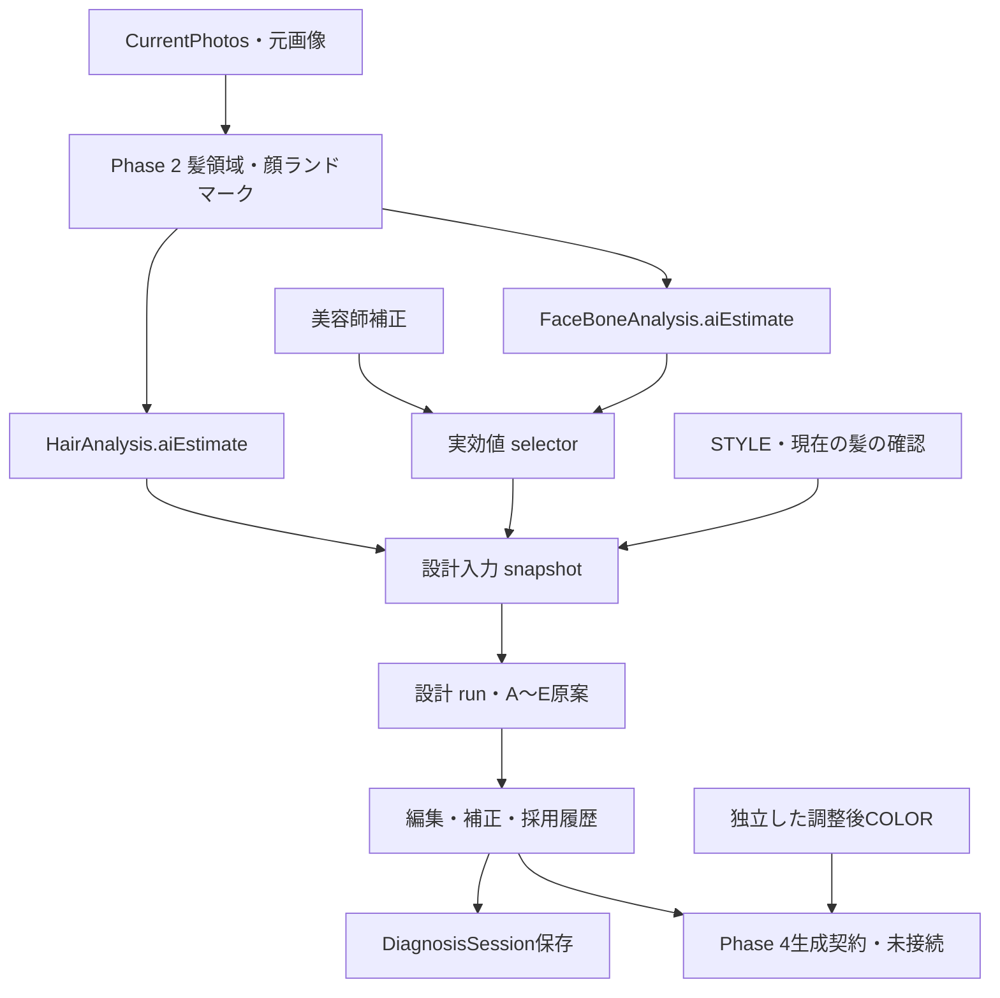

# PHASE_3_IMPLEMENTATION_REPORT

COLOR FUTURE AI / HAIR DESIGN LAB · 2026-10-04

正式基準：MASTER SPECIFICATION v1.0 + v1.1 ADDENDUM、GAP REPORT、Phase 1/2 IMPLEMENTATION REPORT。今回の範囲は **Face/Bone → デザイン試案A〜Eの設計・編集・採用・保存・将来生成契約**。Phase 4の本人実写生成へは進んでいない。

**接続・保存・操作はREAL。デザイン設計全体はPARTIAL、出力はESTIMATE。** 顔の画像AI推定に、未検証の明示的なデザインルールを適用する実装であり、学習済みの「似合わせAI」やLLMによる設計を接続したものではない。美容師による妥当性確認が必要。

## 1. 変更したファイル

| 区分 | ファイル | 内容 |
|---|---|---|
| 新規 | `src/lib/effective-face-values.ts` | active AI原本＋美容師補正の実効selector |
| 新規 | `src/lib/design-planning-types.ts` | 設計入力、A〜E、実使用値、欠損・充足度、修正・採用履歴 |
| 新規 | `src/lib/design-planning-engine.ts` | 本人比率で候補のパラメータ/順位を変え、異なる5方向を選ぶ |
| 新規 | `src/lib/design-planning-projection.ts` | アクティブ設計・採用の取得、正規表示への投影、古い提案の解除 |
| 新規 | `src/lib/design-planning-session.ts` | 設計、入力確認、編集中、補正保存、採用を同一セッションへ追加 |
| 新規 | `src/lib/design-planning-validation.ts` | 根拠・出所・親子・補正/採用参照・原本不変性の検証 |
| 新規 | `src/lib/takeaway-contract.ts` | v1.1将来モジュールの型契約のみ |
| 新規 | `src/components/design-planning-panel.tsx` | STEP 03の5案・構造プレビュー・根拠・編集・採用 |
| 変更 | `session-model.ts`, `session-validation.ts`, `session-adapter.ts`, `journey-store.ts` | planning追加、v1.0/1.1互換、履歴保護、保存版の仕様追跡 |
| 変更 | `analysis-contract.ts`, `generation-contract.ts` | セッションのspecVersion継承、実効値/採用/MAIN→5案の契約 |
| 変更 | `photo-analysis-pipeline.ts` | 美容師が顔/毛髪/領域を修正した直後にセッションを同期 |
| 変更 | `feature-registry.ts` | 接続・推定試案・旧MOCK・実写/将来モジュールの状態分離 |
| 変更 | `counseling-studio.tsx`, `style-reference-editor.tsx`, `reference-home.tsx`, `hair-image-panel.tsx`, `app/globals.css` | STYLEの次階層へ配置、採用表示、ホーム前髪導線、未接続の注記、サロン配色 |
| テスト | `tests/design-planning.test.mjs`, `tests/session-foundation.test.mjs` | Phase 3の27件、仕様版の検査更新 |
| ブラウザ | `scripts/design-planning-ui.mjs`, `scripts/session-foundation-ui.mjs` | 実モデルからの設計/保存/再読込、旧版互換 |
| 文書 | `docs/specs/COLOR_FUTURE_AI_MASTER_SPEC_v1.1.md`, `MASTER_SPEC_v1.1_ADDENDUM.md`, `IMPLEMENTATION_PHASE_3.md`, `docs/V1_1_EXTENSION_ARCHITECTURE.md`, `AGENTS.md`, `README.md` | 正式仕様と実装範囲、将来接続位置、確認手順 |

上表の略記したlibファイルは `src/lib/`、コンポーネントは `src/components/`。FIOLEデータ、モデル/SDK/WASM、元画像アセット、旧報告書、旧固定前髪モジュール、既存generate APIは変更していない。Phase 3開始時203ファイルとの比較で削除0。生成キャッシュは配布対象外。

## 2. 使用したFace/Bone値

| キー | 使用方法 | 注意 |
|---|---|---|
| `faceHeightWidthRatio` | 前髪幅、顔周り長さ、候補の順位 | 顔表面の2D縦横比。設計の最低入力 |
| `cheekbonePosition` | 頬付近の動き、顔周り長さ/位置 | 頬付近の画像ランドマーク。実際の頬骨寸法ではない |
| `midfaceRatio` | 曲線の顔周り接続と候補順位 | 画像上の眉〜鼻底等に基づく代理比率 |
| `lowerFaceRatio` | 顔周り開始と接続の方向 | 画像上の下顔面比率 |
| `jawWidthRatio` | 顎周辺へつなぐ毛流れと順位 | 物理的な顎の骨格計測ではない |
| `browEyeDistance` | 前髪の長さ、目元/額の見え方 | 正規化した画像上の間隔 |
| `eyePosition` | 目元へ視線をつなぐ候補順位 | 正規化した顔表面位置 |

各案が使うキーは異なる。`usedMetrics`に**実効値のスナップショット、sourceType、correctionId、使用rule IDs**を記録する。`basedOnFaceBoneAnalysis.metricKeys`がbasedOnMetricsに相当し、実使用キーと一致させる。`valuesWereUsed`は非nullの観測値を本当に使用したときだけtrue。

選択順は美容師補正 → active AI原本 → null。明示的な「不明に戻す」補正はnullを維持し、AI値へ勝手に戻さない。別の古いAI原本の補正も混ぜない。

生え際・額・頭頂・ハチ・後頭部・3D骨格は補完しない。髪領域、色、顔ランドマークのproviderはPhase 2の **MediaPipe Tasks Vision 1.0.1 / hair_segmenter-float32-v1 / face_landmarker-float16-v1**を維持。追加の設計用AI provider/API呼出しはない。

## 3. A〜E生成ロジック・固定ルール部分

1. `designPlanningInput`で本人写真ID、実効顔値、実効ROOT/MID/END、現在の髪の確認値、STYLE構造化条件をスナップショット化。COLORは形の設計入力へ混入させない。
2. 横へ視線をつなぐ、縦ライン、斜めの流れ、頬付近の動き、目元、顎への接続、抜け感、曲線、前髪ライン、外向きの動き、という**10の視覚効果候補**を計算。
3. 実際の比率、確認済み毛量/毛流れ/長さ/前髪有無/仕上げ方向、STYLEのレイヤー/位置などでパラメータと順位を変える。
4. 候補間のパラメータ差を確認して5方向を選択し、その後A〜Eのラベルを付ける。同じ固定5案を毎回返す処理ではない。
5. 現在の条件から生成した原本を変更せず、別の編集/補正/採用履歴を保存する。

10候補の視覚効果、設計閾値、順位重み、多様性選択は**人が記述した固定ヒューリスティック**。例えば縦横比1.2/1.35、頬付近位置0.48等を設計制御に使用するが、医学的な顔型分類や検証済みの似合わせ境界ではない。毛量/毛髪太さに対する密度調整も美容師確認を前提とした試案。

STYLE写真は参照画像として保持し、次の画像生成契約へ渡す。**写真の髪型の自動抽出、自由文の意味解釈は未接続。** 今回の設計へ実際に反映するのは取得/確認済みの構造化条件のみ。STYLEの全形状を理解した設計として表示しない。

各案は前髪長・幅・密度・分け目・毛流れ、サイドバング長、顔周り開始・長さ・流れ・動きの位置の10項目を持つ。提案パラメータは計測値ではなく、デザイン候補の条件。

## 4. 欠損・confidence設計

- 顔縦横比が未取得/不正/固定MOCKの場合、正式5案の設計を止めてSTEP 02の確認を案内する。旧MOCK値へ自動フォールバックしない。
- 任意の比率や毛髪条件がnullならnullのまま保存し、`missingInputs`へ未確認項目を記録。既知の比率から控えめな試案を作る。
- 現在の短い髪に長めの案を提案する場合等は長さの実現可否確認を記録する。髪が伸びる/切れる等の断定をしない。
- STYLE写真の自動形状解析、自由文の解釈が未接続であることも不足入力に記録。
- `confidence`は取得/確認済み入力数に基づく **未検証の入力充足度**。0.1〜0.7に制限し、`confidenceMethod: UNVALIDATED_INPUT_COVERAGE_NOT_PROBABILITY`で保存する。似合う確率、AIの統計的信頼確率、実現確率ではない。
- 全案で`needsStylistConfirmation: true`。画面の詳細にも限界を表示する。

## 5. 美容師修正・採用と保存

`DesignPlan.planning`に以下を保持する。

| データ | 意味 | 保護 |
|---|---|---|
| `currentHair` | 長さ/毛量/前髪/毛流れ/仕上げ方向の美容師確認 | 不明はnull、既知値に出所を付加 |
| `runs` | 入力スナップショット＋AI画像推定に基づく設計原案5方向 | 追記のみ。保存済み原本の改変/削除を拒否 |
| `drafts` | 編集途中の10パラメータ | 原案と独立 |
| `corrections` | 美容師が保存した変更 | 原案・run ID・担当者・日時を参照、追記のみ |
| `selections` | 美容師が採用した1案と確定パラメータ | 保存済み補正または原案を参照、追記のみ |
| `activeRunId`, `selectedSelectionId` | 現在の入力に対応する設計/採用 | 入力変更時に解除。古い原本/採用履歴は保持 |

「変更を保存」と「この案を採用」は別操作。編集中のまま採用できない。採用パラメータをSTYLEの前髪/顔周りへ投影する。再設計は以前の採用を自動引継ぎせず、再度選択する。

写真、active解析、顔/髪の補正、現在の髪条件、STYLE入力が変われば再設計を要求する。COLORだけの変更では形の案を無効化しない。旧固定A〜Eとその決定履歴は既存`faceDesign`に保持し、MOCKの互換欄で参照できる。

## 6. UI

ホームの4STEP、サイドバー、写真カード、Before/After配置を維持。情報はSTEP 03 STYLEの次階層へ配置した。

操作順：現在写真 → STEP 02で髪/顔を解析 → STEP 03 STYLE設定 → 必要なら現在の髪/仕上げ方向を確認 → 5案を設計 → 構造図と視覚効果を比較 → 必要なら編集して変更を保存 → 1案採用 → 相談保存。

5案は`DESIGN STRUCTURE PREVIEW`。簡易図は前髪長/幅/密度/分け目の有無/顔周りの方向などを示す構造説明で、全パラメータの精密描画や本人実写の代替ではない。最終RESULTへイラストを完成画像として追加していない。

既存単枚生成の画面には「Phase 3の新しいA〜E設計はまだ反映されない」と明記。既存generate APIや旧生成履歴を保持しつつ、新しい設計結果の実写生成済み表示を避ける。

## 7. generation-contract

既存`hair-generation-contract-v1`は破壊せず拡張。次の情報を渡せる。

- 本人元画像参照、STYLE形状用参照、COLOR元画像/確定した調整後プレビュー、COLOR調整値。
- HairAnalysisと実効ROOT/MID/END、FaceBoneAnalysis原本/補正と実効顔値。
- `selectedDesign`のID、採用履歴ID、確定パラメータ。
- 各A〜Eの`parentDesignId`, `variantType`, `designParameters`, AI原案、`sourceAnalysisIds`, `generationSeedMetadata`。

`generationBatchContract`はMAIN＋5子案をまとめ、`GENERATE_MAIN_THEN_VARIANTS`の依存関係を定義。同じ本人・基本STYLE・調整後COLORを共有する。子案の前髪/顔周り条件が基本STYLEの該当項目を上書きする優先関係を明示する。

seed・親生成request IDは**未取得なのでnull**。契約状態は`INTERFACE_ONLY_NOT_CONNECTED`。Phase 3では生成APIへ送信しない。旧設計が古い条件になった場合、その子を生成契約へ渡すことを拒否する。

## 8. REAL / ESTIMATE / MOCK / PARTIAL / 未実装

| 機能 | 状態 | 動いている範囲 / 未接続範囲 |
|---|---|---|
| 実効値selector、顔値→設計接続 | REAL | 補正優先、null安全、根拠参照、原本保持 |
| 設計エンジン全体 | PARTIAL | 画像推定＋未検証ルールが動作。学習済み似合わせモデル/STYLE画像理解はなし |
| A〜Eの条件設計 | ESTIMATE | 実観測値を使うルール試案。科学的/経験的精度は未検証 |
| 5案の編集・採用・セッション保存 | REAL | 実ブラウザ/IndexedDBで確認 |
| 顔/骨格解析 | PARTIAL | Phase 2の2Dランドマークと比率。額/生え際/頭部/3Dはnull |
| 毛髪解析 | PARTIAL | 実モデル髪領域と画像上の未校正色。損傷・吸い込み等は美容師確認 |
| 旧固定A〜E | MOCK | 折りたたみ内へ保持、新しい設計原本と分離 |
| 生成契約 / MAIN→A〜E契約 | REAL | データ準備・役割/親子参照のみ。API未接続 |
| 正式MAIN、本人実写A〜E、長さ5画像 | 未実装 | Phase 4以降。今回画像生成POSTは0 |
| 必要アンダー本計算、FIOLE最適化、実績学習 | 未実装 | 既存モデル/手入力/試算は保持 |
| CustomerTakeaway、ProductCatalog、次回案、メイク、商品推薦 | 未実装 | v1.1型契約・将来依存関係のみ |
| iPad/iPhone実機Safari | 未検証 | Chromiumの画面サイズ/操作テストと実機検証は別 |

出所と機能状態を混同しない。設計原案の`sourceType: AI_ESTIMATE`は画像推定値から派生した試案を識別し、`planningMetadata.method: MEASUREMENT_DRIVEN_RULES` / `validation: UNVALIDATED`で実際の生成方法を明示する。

## 9. v1.1正式追記・互換

v1.0正式原本を保持し、v1.1のCustomerTakeaway / ProductCatalog / 次回カラー・デザイン / MakeupSuggestion / 商品推薦と理由 / 将来RESULTタブ・出力形式を追記。詳細な依存設計は`V1_1_EXTENSION_ARCHITECTURE.md`。

`RecommendationLayers`でAI提案・美容師選択・美容師編集を分離。商品はサロン台帳ID/revisionと選択時スナップショットを参照する設計。自動販売確定は行わない。登録UI、商品DB、推薦エンジン、文章生成、PDF/QR/LINE共有は作成していない。

`schemaVersion / dataSchemaVersion: diagnosis-session-v1`を維持し、設計には独立した`design-planning-v1`。追加項目をoptionalとし、旧v1.0を読み込める。読込だけで旧版を上書きしない。Phase 3操作/新保存版は`specVersion: 1.1`, `appVersion: 0.1.0-phase.3`。FeatureRegistryは`phase3-features-v1`。未対応の将来版は原データを保持して拒否。

## 10. 検証

| 検証 | 結果 |
|---|---|
| `npm test` | PASS · 110件（既存83＋Phase 3の27） |
| `npm run typecheck` | PASS |
| `npm run build` | PASS · Next.js 16.3.8本番ビルド |
| Phase 3ブラウザ実モデル→設計→保存 | PASS · Worker CPU / MediaPipe実推論 |
| 5案比較、補正、採用、再読込、古い案解除、再設計 | PASS · 1194×834 / 1024×768、5案が横一列 |
| Phase 2撮影/解析回帰 | PASS · メインスレッドCPU、4方向、仮想カメラ、3200×4000元画像、EXIF Orientation 6、髪領域修正、保存・原本保持 |
| 旧カルテ/保存版互換のブラウザ検証 | PASS · IndexedDB旧版保持、補正・再保存、再読込 |
| 生成API POST / 外部への写真POST | 0件（今回の検証範囲） |
| iPad/iPhone実機・実カメラ・Safari | 未検証 |

テスト対象は実値受渡し、補正優先、null/非MOCK、5案の差・比率変更による案変化、実使用キー/valuesWereUsed、欠損/充足度、STYLEとの結合、COLOR非混入、補正/採用分離、古い案の無効化、契約引継ぎ、親子・出所・版・追記不変性。

テストの合格は似合わせ精度の証明ではない。単体テストは明示的な合成provider出力を用い、別途ブラウザで実モデルを動かした。試験画像は全方向の撮影精度を代表するものではない。実サロン・多様な長さ/毛量/顔隠れ・端末等での美容師評価が必要。

## 11. データ接続

## 12. 未解決点・Phase 4への準備

**データ契約と保存の面ではPhase 4へ接続できる。** ただし本人実写の生成品質や似合わせ精度が検証済みという意味ではない。

次に接続する順序：

1. 美容師による5方向・ルール・簡易図と実際の施術可能性の確認。STYLEの画像特徴抽出をどの範囲で接続するか決める。
2. 現在本人＋STYLE形状＋調整後COLOR＋採用前髪/顔周りを正式MAIN DESIGN生成契約へ接続し、同一人物の維持を確認する。
3. MAINの実生成IDを親にA〜Eの子生成を接続。共通STYLE/COLOR、役割分離、人物維持、実生成seed/requestの扱い、再試行を検証する。
4. 本人実写A〜Eの一括比較と選択後の再編集を検証。iPad/iPhone Safariと実撮影を確認する。

必要UNDER・薬剤発色/LIFT・FIOLE最適化・v1.1推薦/共有は別工程。今回新しい薬剤の数値や発色Labを追加していない。

**Phase 3終了後、ユーザーの確認を待つ。Phase 4は未着手。**

## 配布ZIP

最新版ソース、同梱解析モデル/SDK/WASM、既存FIOLEデータ・画像、仕様・報告書・検証記録を通常のDeflate ZIPにまとめた。中央ディレクトリ/EOCD、全CRC、試験解凍後の全ファイルSHA-256一致を確認。暗号化・ZIP64は不使用。依存関係のインストール先、生成キャッシュ、以前の配布ZIPは含めない。iPadのファイルアプリそのものでの解凍は実機未検証。
