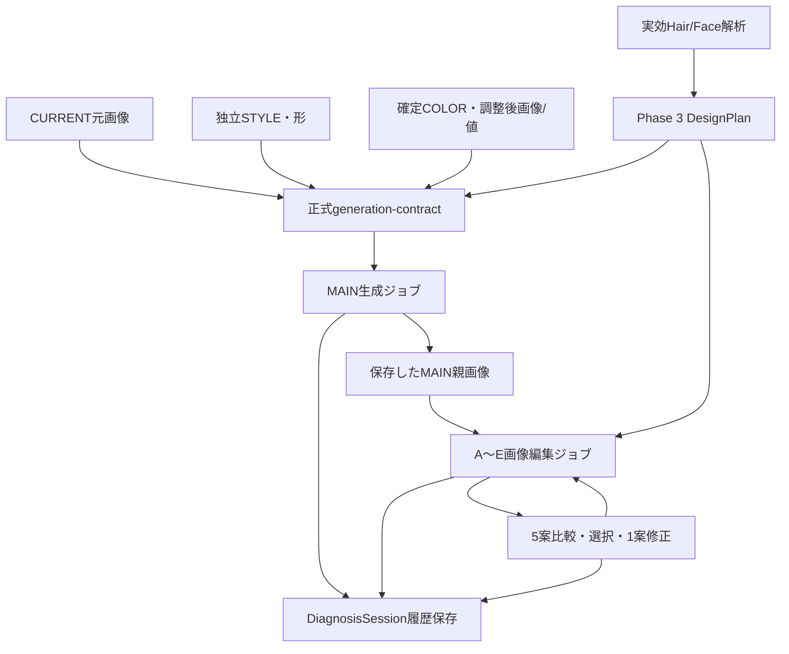

# PHASE_4_IMPLEMENTATION_REPORT

COLOR FUTURE AI / HAIR DESIGN LAB · 2026-10-04

正式基準：MASTER SPECIFICATION v1.1、Phase 1/2/3 IMPLEMENTATION REPORT、今回のIMPLEMENTATION PHASE 4。マスター原本と過去報告は変更していない。

**Phase 4の契約/API接続・ジョブ・保存・比較・個別再試行・編集を実装した。実画像生成はAPIキー未設定により0枚・未検証。画像生成機能全体はPARTIALで、Phase 4の最終完了判定は保留。**

MAIN＋A〜Eを本人実写で生成できたと報告する段階ではない。通信テスト用の写真は必ずMOCKとして保存・表示し、実生成の代用にしない。Phase 5へは進んでいない。

## 1. 正式仕様・既存データの保護

- 正式原本：`docs/specs/COLOR_FUTURE_AI_MASTER_SPEC_v1.1.md`。参照したv1.1原本更新日時は2026-10-04T05:55:55.595389Z。
- Phase 1報告更新：2026-10-04T01:38:02.821009Z、Phase 2：2026-10-04T04:27:21.004254Z、Phase 3：2026-10-04T05:55:55.616104Z。
- 作業開始時のローカルコードに古いPhase 1相当のファイルが残っていたため、正式なPhase 3一式を照合・復元してから差分を実装。入替前のローカルファイルはバックアップし、独自削除していない。
- Phase 3配布原本ZIPのSHA-256：`d350d5117e43c55525ec1a829090c79483a0ca87538415eca4baa5d84d2eccda`。
- 開始時220ファイルとの照合で削除0。FIOLEデータ、解析モデル/SDK/WASM、マスター原本、Phase 1/2/3報告を含む保護対象20ファイルはSHA-256一致。記録は`docs/verification/phase4/source-preservation.json`。

旧カルテ・旧保存版は初期化しない。画像生成は既存カルテIDと同じDiagnosisSessionへoptionalの追加モデルとして保存する。旧単枚生成/API形式/生成履歴と旧MOCK前髪は折りたたみ内へ残した。

## 2. 変更したファイル

| 区分 | ファイル | 内容 |
|---|---|---|
| 新規 | `src/lib/hair-simulation-types.ts` | batch/job/event/asset/selection/review、親子、状態、生成出所の契約 |
| 新規 | `src/lib/hair-simulation-context.ts` | 入力の署名、ACTIVE/STALE、共通デザインへの画像投影 |
| 新規 | `src/lib/hair-simulation-session.ts` | キュー、MAIN依存、開始/完了/失敗、採用、画像確認、中断回復 |
| 新規 | `src/lib/hair-simulation-validation.ts` | 共通STYLE/COLOR・親・出所・履歴の整合性と追記原本保護 |
| 新規 | `src/lib/hair-simulation-instructions.ts` | PERSON/STYLE/COLOR役割分離と髪のみの生成指示 |
| 新規 | `src/lib/hair-simulation-api.ts` | 既存APIの正式契約処理、画像編集、原画像ハッシュ、重複防止 |
| 新規 | `src/lib/hair-simulation-client.ts` | 元画像multipart送信、応答/親ID検証、画像デコード |
| 新規 | `src/lib/hair-simulation-pipeline.ts` | MAIN→A〜Eの順次処理、自動保存、部分失敗・個別実行 |
| 新規・変更 | `src/lib/journey-storage-codec.ts / src/lib/journey-store.ts` | 新しい生成カルテの可逆gzip保存・読込アダプター、旧版保持、保存版競合チェック |
| 新規 | `src/components/hair-simulation-panel.tsx` | MAIN比較、5枚比較、選択、1案編集、再試行、確認・履歴 |
| 変更 | `app/api/generate/route.js` | 正式契約へ分岐、接続GET、既存単枚POSTの互換維持 |
| 変更 | `session-model.ts / session-adapter.ts / session-validation.ts / generation-contract.ts` | optional領域、画像解決、同じセッションへの投影/検証、API準備状態 |
| 変更 | `design-planning-projection.ts` | 明示したSTYLE_ONLY/COLOR_ONLYを採用操作で勝手に変更しない |
| 変更 | `feature-registry.ts` | 実ジョブ管理と実生成未検証を別状態にする |
| 変更 | `counseling-studio.tsx / reference-home.tsx / design-planning-panel.tsx / hair-image-panel.tsx / app/globals.css` | 正式RESULTの配置、ホーム採用画像、旧機能の階層化、保存更新の負荷低減 |
| 変更 | `takeaway-contract.ts / docs/V1_1_EXTENSION_ARCHITECTURE.md` | 将来のMAIN生成ID/採用生成ID/画像ID参照のみ |
| 新規・変更 | `tests/hair-simulation.test.mjs / tests/journey-storage-codec.test.mjs / tests/helpers/simulation-fixture.mjs`、既存テスト | 33追加、Phase 4状態と既存route importの対応。既存テストを削除しない |
| 新規・変更 | `scripts/hair-simulation-ui.mjs / scripts/design-planning-ui.mjs` | MOCK通信による実UI/IndexedDB確認、既存解析/設計の回帰 |
| 文書 | `README.md / AGENTS.md / docs/specs/IMPLEMENTATION_PHASE_4.md`、本報告、検証JSON | 範囲・状態・実生成未検証・起動/確認手順 |

略記したlibは`src/lib/`、UIは`src/components/`。依存ライブラリの新規採用・マスター本文の改変・リポジトリへのpush・新しい公開デプロイは行っていない。

## 3. Provider / model / MAIN生成方法

| 項目 | 設定・実態 |
|---|---|
| Provider | OpenAI Images Edit API |
| Endpoint | `https://api.openai.com/v1/images/edits` |
| アプリEndpoint | 既存`POST /api/generate`を再利用 |
| Model | `OPENAI_IMAGE_MODEL`。未指定時`gpt-image-2`を維持 |
| 生成 | 1リクエスト1画像、PNG、medium、1024×1536 |
| 入力 | 本人元画像、独立STYLE参考、確定COLOR調整後画像、設計/実効解析値 |
| Seed | 対応する正式フィールドを使用せず常にnull |
| 入力忠実度 | gpt-image-2では自動。非対応のinput_fidelityを追加しない |
| 実生成 | サーバー側OPENAI_API_KEYなし。外部画像生成POST 0件 |

APIキーは環境変数でのみ使用し、ブラウザ、ソース、ZIP、報告へ含めない。GETで接続状況だけを確認し、キーがない場合は実生成ボタンを利用不可として理由を表示する。成功を装うサンプルへのフォールバックはない。

MAINは本人のFRONT元画像を優先し、なければ登録済みの元画像を使用。縮小表示画像を元画像として扱わない。JPEG/PNG/WebP各20MB、合計65MBを上限とし、大きすぎる元画像は無断縮小せず、撮影/保存データを保持したまま説明を表示する。HEICの生成API変換は今回未接続。

STYLEは形状の参照、COLORは確定済みの髪色の参照。COLORスライダーが適用済みのプレビューを送るため、生成指示では二重にスライダー補正しない。元COLORは同じセッションに別保存したまま保持。

## 4. MAIN → A〜E

MAINがCOMPLETEになってからA〜Eを順に送信する。入力画像の順序は次の通り。

1. 同じCURRENT本人元画像。
2. 実際に取得・保存したMAIN画像（子案のみ）。
3. 同じSTYLE形参考（設定した場合）。
4. 同じ確定COLORプレビュー（設定した場合）。

APIは複数参照の画像編集に対応しているため、実装は`parentMode: IMAGE_EDIT`。LOGICAL_PARENTへ黙って切り替えない。**テストでMAINと同じ画像bytesが全Childのmultipartに含まれることは確認したが、実APIでの親編集の画質は未検証。**

各Childの`parentDesignId`はMAINのdesignId、`parentGenerationId`は実際のMAIN完了イベントID。共通STYLE/COLORと本人入力を固定し、Phase 3の対応するdesignId、A〜Eラベルと実効パラメータだけを変える。別のDesignPlanや別の親画像を送ろうとすると開始/保存時に拒否する。

顔分析は髪を設計する根拠。本人の顔を理想化する処理は追加していない。Face/HairのAI原本と美容師補正を両方スナップショットへ保存し、指示には補正優先の実効値を渡す。

髪型のみでは現在色維持のMAIN＋A〜E。カラーのみでは現在のカット・前髪・形を維持するMAIN1枚。カラーのみで勝手に前髪を変える5案を生成しない。長さ5種は親ID/enum/条件の構造を保持し、今回の画像生成へは接続していない。

## 5. 本人・STYLE・COLOR・DesignPlanの維持方法

生成指示はidentity、顔/目/鼻/口/顎/輪郭、表情、年齢感、肌、背景、服装、ポーズ、角度、構図を維持し、主に髪を編集することを明示。美肌加工・若返り・顔補正を目的にしない。

自然な生え際、毛流れ、密度、根元、光/影、ウィッグ状にしない指示を含める。A〜EではMAIN全体の長さ・レイヤー・シルエット・カール・ボリューム・髪色を維持し、前髪/顔周り10パラメータを優先する。

STYLE参考の人物/髪色、COLOR参考の人物/髪型を使用しない指示を個別に記述。確定COLORの画像・調整値・表示RGB/HEX・未校正Lab/LChを画像生成にも渡す。レシピ専用にはしていない。

**これらは生成条件であり、画像の一致を保証する処理ではない。** 実生成後、本人/背景/色/前髪差を人が確認する。完全な自動品質判定は未実装。

## 6. ジョブ・再試行・微調整

- 初回は1操作でMAIN→A→B→C→D→E。現在の生成案を簡潔に表示。
- MAIN失敗時は子を送らない。「MAINと残りの案を再試行」で再開。
- Child失敗時は残りの案へ進み、成功画像を保持。失敗した1案のみ明示的に再試行。
- 1ジョブは初回＋最大2回の再試行。完了済み同条件の一括生成は抑止。
- A〜E選択後、長さ・幅・厚み・分け目・毛流れ・サイド/顔周りを編集し、修正を別履歴へ保存してその1案だけ再生成。
- AI原案を上書きしない。新しい生成と過去の画像の両方を残す。
- サーバー285秒/クライアント300秒の待機上限。勝手な再送はしない。
- 待機中断/再読込では、サーバーで生成が完了・課金済みの可能性を残し、FAILEDとして明示する。実行結果不明のまま自動再生成しない。
- 同一requestId＋同一入力は同一プロセス内で重複API呼出しを抑止。入力が違えば409。

重複キャッシュは10分/最大12件のメモリ内方式。サーバー再起動や複数インスタンスをまたぐ永続ジョブ保証は未実装。今回は保護されたデモ向けで、ログイン/課金/公開サービスの利用制限を完成させたものではない。

## 7. 保存モデル・バージョン

`DiagnosisSession.hairSimulation`をoptional追加。既存`dataSchemaVersion: diagnosis-session-v1`、`specVersion: 1.1`を保持。追加領域は`hair-simulation-v1`、新しい保存版のappVersionは`0.1.0-phase.4`。読込だけで過去版を上書きしない。

| 領域 | 保存内容 |
|---|---|
| batches | 同一セッション、DesignPlan run、MAIN/子の初回契約、共通入力署名、写真のスナップショット |
| jobs | MAIN/A〜E、designId、parentDesignId、variantType、作成日時、名称/視覚効果 |
| events | QUEUED/GENERATING/COMPLETE/FAILED、requestId、生成時点の正確な契約、parentGenerationId、結果/エラー |
| generatedAssets | 画像bytes、画像ID、サイズ、参照、AI_ESTIMATEまたはMOCKの出所 |
| selections | 選択した案・生成イベントID・日時・美容師。再生成前の選択も保持 |
| reviews | 美容師による一致確認/不採用とメモ。生成API成功とは別の判断 |

入力スナップショットにはCurrentPhoto、StyleTarget、ColorTarget、HairAnalysis、FaceBoneAnalysis、実効値、DesignPlan/パラメータ、根拠IDを保存。生成結果メタデータにはprovider/model/promptVersion、providerRequestId、日時、usage、実画像ハッシュ、seed nullを保存。クライアントrequestIdとproviderのrequestIdは別管理。

UIのSTALEは署名/実効パラメータの比較で判定し、過去イベントを書き換えない。STYLE/COLOR/現在写真/解析が変われば全体を以前の条件として保持。美容師が子案だけを補正すれば、その1案のみSTALEとする。

共通`MainDesign.generatedImage`、各A〜E、`DiagnosisSession.simulations`へ参照を投影。実施後`AfterPhotos`やActual Treatmentとは分離。将来Takeawayは生成イベントID/画像IDとカルテrevisionから参照可能で、機能自体は追加していない。

生成前と完了/失敗ごとに既存IndexedDBへ保存。選択直後の編集で保存が競合しないよう、保存処理を順番に実行する。生成進行中に全カルテ履歴を毎回一覧再読込せず、更新した最新カルテだけを一覧へ反映する。

ブラウザ検証で、完全スナップショットを何度も保存すると容量上限に達することを確認した。旧保存版はそのままにし、新しい生成カルテのrevisionだけを`journey-json-gzip-v1`で可逆圧縮する保存アダプターを追加。復元後のJSON・元画像bytes・AI原本・生成条件は一致する。保存済みの旧revisionをまとめて圧縮/移行する処理は行っていない。

CompressionStream/DecompressionStreamが利用できる環境のみ圧縮。非対応環境では従来のraw保存へ戻る。読込はraw/gzipを判別し、未知版/破損/版不一致は原本を保持して拒否する。圧縮は書込トランザクションの外で実行し、書込直前にも保存版を照合して他画面の更新を上書きしない。画像アセットの完全な独立保存・長期大量履歴の最適化とiOS実機容量確認は今後必要。

## 8. FeatureRegistry・出所

Registry版：`phase4-features-v1`。実API未検証という欠損をコード内の状態/説明にも保持する。

| 機能 | 最新状態 | 確認範囲・不足 |
|---|---|---|
| 生成契約・親子データ・ジョブ/履歴管理 | REAL | 契約、写真bytes、依存、追記、状態、保存の実処理 |
| MAIN生成 | PARTIAL | API処理実装、通信テスト合格。実画像API未検証 |
| 本人実写A〜E | PARTIAL | 実親画像を送る5ジョブ、比較、再試行。実画像API/画質未検証 |
| 一括生成 | PARTIAL | UI/保存/部分失敗処理。実生成6枚の確認未了 |
| 生成画像確認 | PARTIAL | 形式/親ID/契約検証、美容師の確認/不採用。自動人物/背景/色/差分評価は未実装 |
| 既存顔ランドマーク | ESTIMATE | MediaPipe実推論。物理骨格ではない |
| 既存髪/顔分析・デザイン設計 | PARTIAL | 取得可能な画像値＋未検証の設計ルール。未知値はnull |
| A〜E設計パラメータ | ESTIMATE | Phase 3の画像推定値/確認値に基づく設計試案を維持 |
| COLORライブ調整/確定、FIOLEライブラリ、カルテ | REAL | 既存機能保持 |
| 通信テスト画像・以前の固定案 | MOCK | 模擬応答/サンプル。実AI生成/実施結果とは区別 |
| 長さ5種実写、必要UNDER/LIFT/PRE-LIFT/ON COLOR本計算、FIOLE最適配合 | UNIMPLEMENTED | データ契約/以前の試算を保持。今回本計算なし |
| CustomerTakeaway/ProductCatalog/次回/メイク/商品/学習/課金/ログイン | UNIMPLEMENTED | 将来契約のみ。今回は本実装しない |

画像APIが返した実生成のみ`REAL_API`。テストtransportは`MOCK_TRANSPORT_FIXTURE`で、保存画像のsourceTypeもMOCK。実生成画像の出所AI_ESTIMATEは「画像生成AI」の意味であり、実測毛髪色/メーカー発色/施術Afterを示さない。

## 9. テスト・実生成数・コスト

| 検証 | 結果 |
|---|---|
| 単体/統合テスト | PASS · 143件（既存110＋追加33） |
| Typecheck | PASS |
| Production build | PASS · Next.js 16.3.8 |
| Phase 3実モデル→設計→保存の回帰 | PASS · MediaPipe Worker CPU、4方向、原本/美容師補正分離、旧案保持、再読込 |
| Phase 4ブラウザ | PASS · MAIN＋5案、部分失敗、Dのみ再試行、Bのみ修正再生成、保存/再読込/STALE |
| 旧カルテ/共通モデルの回帰 | PASS · raw保存互換、AI原本/美容師補正、保存版保持 |
| iPad/iPhone実機・実カメラ・Safari | 未検証 |
| 実画像生成POST / 実生成画像 | 0件 / 0枚 |
| 実画像API失敗 / 実課金額 | 呼出しなし / 発生させていない |

追加33件は、正式契約→既存API、MAIN依存/保存、A〜E5案、共通STYLE/COLOR、補正1案、選択、個別失敗再試行、STALE、スナップショット/原本保護、親画像bytes、MOCK/REAL、API失敗/未設定、同一requestID重複防止、改変されたDesignPlan/親/応答拒否に加え、圧縮/復元・旧raw互換・非対応fallback・破損/未来版/保存版不一致拒否を確認する。

単体APIテストはfetchを模擬provider応答へ差し替える。コード経路は実行するが、外部実APIへ接続した証拠にはしない。ブラウザは画像応答をMOCKとして差し替え、実UI・実MediaPipe・実IndexedDBと接続を検証する。サンプル本人写真を使用したテスト画像にMOCKの透かしを入れ、前髪差の完成見本とは扱わない。

ブラウザ通信テストは8回のMOCK送信、7枚のMOCK画像保存、Dの模擬失敗1回。Dの再試行1回とBの微調整再生成1回を確認した。保存22版のうち21版を可逆圧縮し、初回raw版は保持。外部画像生成POSTは0件。5枚は異なる設計パラメータで送信するが、テスト画像の前髪差は生成していない。

コスト記録はGENERATINGイベント数＝送信試行数、成功/失敗、providerAttempted、provider/model、usage、requestIdで追跡する。providerがusageを返さなければnull。正確な料金、取得できないseed、確定した課金成功件数を捏造しない。タイムアウト等は「生成/課金済みか不明」として残す。料金表からの自動価格計算は今回未実装。

## 10. UI・スクリーンショット

ホームの4STEPと正式参考デザインを維持。STEP 04の主役をMAINのBefore/After、その下の写真5案へ整理。写真下の短い名前/視覚効果、1案選択、必要時のみ編集/生成条件/過去履歴を開く。以前の単枚画像/サンプルは次階層へ残す。

1194×834 / 1024×768のiPad横画面相当で、5案を同じ横一列に表示する。選択画像を大きく見る/5案比較も用意。iPhoneサイズでは2列で縦スクロールする設計だが、物理端末Safariは未検証。

提出スクリーンショットは**比較UIのMOCK通信テスト**。MAIN＋A〜Eの実API完成写真ではない。実生成後、同じ画面で人が本人/背景/共通STYLE/COLOR/指定前髪差を確認する。今回自動評価値で完成判定していない。

## 11. データ接続

図の生成ノードはAPI接続済みコード経路。実生成成功は未検証。保存・再試行・選択はMOCK transportを含む実処理として検証する。

## 12. 未解決問題・Phase 4の残り確認

1. サーバー側にOPENAI_API_KEYを設定した環境で、MAIN＋A〜E計6枚を最小限実生成する。キーはチャットに貼らず、サーバー環境変数へ設定する。
2. 本人維持、顔/背景/衣服/構図、共通STYLE/COLOR、A〜E差、指定パラメータの一致を美容師が比較。必要なら生成指示を調整する。髪以外の画素を完全固定するマスク合成は未実装。
3. iPad/iPhone Safariでカメラ/ライブラリからの元画像、権限、生成待機、保存/再読込、向き、容量を検証。HEICは必要なら無加工JPEGへの変換を別途対応する。
4. 実画像サイズでのメモリ/IndexedDB容量を確認。将来、画像bytesの独立アセット保存、参照中心のカルテrevision、永続ジョブ/課金記録へ段階的に拡張する。旧版を削除しない。

**Phase 5へは進めていない。データ/API接続の準備はできたが、実本人写真6枚と画質の確認がまだ必要なためPhase 4完了/Phase 5移行は承認待ちの前に未検証として保留する。**

## 13. 次の実生成確認手順

Node.js 24環境で`npm ci`、`.env.example`を参考にサーバー側環境変数を設定し、`npm run build`→`npm start`。`/fiole`から現在写真・実解析・STYLE/COLOR確定・5案設計・一括生成を行う。iPadのカメラはHTTPSで開く。

APIキーがなくても撮影/ライブラリ・端末内解析・STYLE/COLOR調整/確定・設計/記録を確認できる。ZIPの解凍だけではNext.jsアプリは起動しない。

## 14. API参照

2026-10-04にOpenAI公式資料でImages Editの複数画像入力、gpt-image-2の入力忠実度、PNG出力/usageとseed非公開を確認。機能の実生成検証とは別の仕様確認。

- [Image generation guide](https://developers.openai.com/api/docs/guides/image-generation)
- [Images edit API reference](https://developers.openai.com/api/reference/resources/images/methods/edit)
- [GPT Image 2 model](https://developers.openai.com/api/docs/models/gpt-image-2)

## 15. 配布ZIPと確認資料

最新版一式は`hair-style-ai-phase-4-complete.zip`。`hair-style-ai/`をルートとし、ソース、FIOLE資料/構造化データ、ローカル解析モデル、テスト、マスター/各Phase報告、検証JSON/比較画面を含める。環境秘密、依存インストール物、ビルドキャッシュ、git履歴、過去の配布ZIPは含めない。`.env.example`は空の設定例のみ。

標準Deflate・暗号化なし・ZIP64なしで作成し、中央ディレクトリ/終端情報、全エントリーCRC、別フォルダーへの解凍、解凍後のSHA-256一致を検証（PASS）。iPad「ファイル」アプリそのものでは未検証。ZIPの解凍だけでアプリは起動せず、サーバーでNode.js/Next.jsを起動してSafariから開く。

スクリーンショット`COLOR_FUTURE_AI_PHASE_4_PREVIEW.png`はMAIN＋5案の比較UIを示す**MOCK通信テスト画面**。実生成6枚の完成画像ではない。
