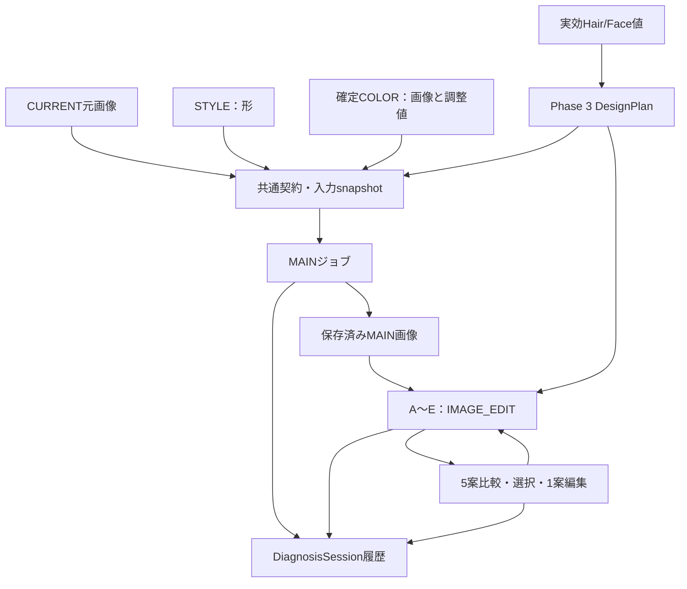

# PHASE_4_RECONSTRUCTION_REPORT

COLOR FUTURE AI / HAIR DESIGN LAB · 2026-10-04

**正常なPhase 3 ZIPだけから、Phase 4の契約・画像編集API経路・生成ジョブ・比較UI・1案修正/再生成・保存を再構築した。残存125ファイルは使用・マージしていない。実画像生成は0件、生成全体はPARTIAL。Phase 4.1とPhase 5は停止。**

元ソースの復元ではなく、正式資料に基づく差分再実装である。失われたPhase 4コードとのバイト単位の一致は保証できない。

## 1. 復旧元と資料の保全

- Phase 3原本：216ファイル、全CRC正常。SHA-256 `d350d5117e43c55525ec1a829090c79483a0ca87538415eca4baa5d84d2eccda`。
- クリーンフォルダへ全展開し、開始時に216/216ファイルを原本と照合。今回の差分後も削除0、193ファイルは同一、23ファイルを変更。
- MASTER v1.0/v1.1、FIOLEの全構造化データ/色番/色素軸、解析SDK/WASM/モデル、Phase 1〜3報告、package/lockはSHA-256一致。
- 元の `PHASE_4_IMPLEMENTATION_REPORT.md` を原文のまま同梱。SHA-256 `ed5b532e723a520abec9d48b26970b642bc20b5a992f693763de4c7f11dced7d`。
- 独立した旧 `IMPLEMENTATION_PHASE_4.md` は見つからず、この会話のユーザー正式Phase 4指示を再収録した文書を `docs/specs/IMPLEMENTATION_PHASE_4.md` として同梱。旧ファイルを復旧したとは主張しない。
- 元の詳細テストソースは欠落。原報告の受入項目とPhase 3の実generation-contractを根拠に、同等の機能を再検証するテストを追加した。

照合根拠：`docs/verification/phase4-reconstruction/source-preservation.json`、`phase3-base-manifest.json`。

## 2. Phase 3から追加したファイル

- `src/lib/hair-simulation-types.ts`
- `src/lib/hair-simulation-context.ts`
- `src/lib/hair-simulation-session.ts`
- `src/lib/hair-simulation-validation.ts`
- `src/lib/hair-simulation-instructions.ts`
- `src/lib/hair-simulation-api.ts`
- `src/lib/hair-simulation-client.ts`
- `src/lib/hair-simulation-pipeline.ts`
- `src/lib/journey-storage-codec.ts`
- `src/components/hair-simulation-panel.tsx`
- `tests/hair-simulation.test.mjs`
- `tests/journey-storage-codec.test.mjs`
- `tests/helpers/simulation-fixture.mjs`
- `scripts/hair-simulation-ui.mjs`
- `scripts/package-reconstruction.py`（完全ZIP作成・独立検証）
- `docs/specs/IMPLEMENTATION_PHASE_4.md`（正式指示再収録）
- `docs/PHASE_4_IMPLEMENTATION_REPORT.md`（元報告そのまま）
- 本報告、および `docs/verification/phase4-reconstruction/` の照合記録/ログ/UI検証結果/明示的MOCKスクリーンショット。

## 3. 変更したファイル

- `AGENTS.md`
- `README.md`
- `app/api/generate/route.js`
- `app/globals.css`
- `docs/V1_1_EXTENSION_ARCHITECTURE.md`
- `scripts/design-planning-ui.mjs`
- `src/components/counseling-studio.tsx`
- `src/components/design-planning-panel.tsx`
- `src/components/hair-image-panel.tsx`
- `src/components/reference-home.tsx`
- `src/lib/design-planning-projection.ts`
- `src/lib/feature-registry.ts`
- `src/lib/generation-contract.ts`
- `src/lib/journey-store.ts`
- `src/lib/session-adapter.ts`
- `src/lib/session-model.ts`
- `src/lib/session-validation.ts`
- `src/lib/takeaway-contract.ts`
- `tests/design-planning.test.mjs`
- `tests/hair-images.test.mjs`
- `tests/integration.test.mjs`
- `tests/photo-analysis.test.mjs`
- `tests/session-foundation.test.mjs`

## 4. 元Phase 4報告との対応

| 元報告の項目 | 再構築した処理・確認 |
|---|---|
| 正式契約→既存API | generation-contract→multipart→既存 `/api/generate` の正式分岐。旧単枚POSTを維持 |
| 本人元画像 | resolveSessionImageのoriginalを使用。縮小表示を原画像と偽装せず、未保存元画像を拒否 |
| MAIN→A〜E | MAIN完了と保存後、保存したMAIN画像bytesを全Childへ送るIMAGE_EDIT。親SHA/親完了イベントIDを検証 |
| STYLE/COLOR分離 | STYLEは形、COLORは確定プレビュー/数値。全Childで共通。役割混入・共通条件の改変を拒否 |
| Phase 3設計対応 | nativeのDesignPlan run/designId/根拠IDと実効10パラメータを使用。AI原案と美容師補正を別保存 |
| 部分失敗/個別再試行 | MAIN失敗時は子を送らない。Child失敗後も残りを処理。初回+最大2再試行、同条件一括の重複を抑止 |
| 選択/編集 | A〜Eから選択し、1案だけ修正を別履歴へ保存して再生成。再生成後の新画像は再選択する |
| 保存/STALE | optional hairSimulation、追記専用履歴、snapshot、旧画像、旧単枚履歴を保持。入力変更は全体STALE、子補正は当該案だけSTALE |
| 可逆保存 | 新しい生成カルテrevisionだけjourney-json-gzip-v1。旧raw版はそのまま。破損/未来版/保存版不一致を拒否 |
| RESULT/ホーム | MAIN Before/After、5列写真比較、名称/効果、採用/1案編集/履歴。ホームは採用画像/現在条件のMAINを参照 |
| FeatureRegistry | phase4-features-v1。ジョブ管理REAL、生成/品質PARTIAL、テスト画像MOCKをコードとUIで区別 |
| v1.1将来契約 | MAIN/採用生成/画像IDへのoptional参照のみ。CustomerTakeaway等の本実装なし |
| 秘密情報/範囲 | 環境変数方式。キーなしで実生成を拒否。外部画像生成POST 0。Phase 4.1/5へ進まない |

## 5. 復元した生成・保存フロー

1. 現在写真の解析用元画像、独立STYLE、確定COLOR、Hair/Face原本+実効補正、選択/生成DesignPlanをsnapshot化。
2. MAINジョブを開始前に同じDiagnosisSessionへ保存。
3. MAIN結果を保存。保存失敗時は子案を送らず停止。
4. CURRENT本人・保存済みMAIN・STYLE・確定COLORの順でA〜E編集入力へ渡す。子ごとの前髪/顔周りだけを変更。
5. 比較、選択、美容師による1案修正、個別再生成。過去結果・選択・不採用も保持。
6. 元画像/入力snapshot/生成画像/親ID/出所/usage/リクエスト/エラーを保存・再読込。

図は接続済みコード経路。実画像APIでの生成成功・画質を確認した図ではない。

## 6. Provider/model・親画像・本人維持

OpenAI Images Edit API、既存POST `/api/generate`。`OPENAI_IMAGE_MODEL` を使用し、未指定時は既存の `gpt-image-2` を維持。PNG/medium/1024×1536/n=1。新しいモデルを勝手に採用・実検証した扱いにしない。

MAINの本人入力はFRONTを優先し、解析元のoriginal bytesを送る。Childは同じCURRENT、実際に保存したMAIN、STYLE、確定COLORを送る `parentMode: IMAGE_EDIT`。論理親へ自動フォールバックしない。対応するseedをAPIへ指定せず、取得できない値はnull。

本人の顔/目/鼻/口/顎/輪郭/表情/肌/年齢/背景/服装/ポーズ/アングル/構図維持、髪のみの変更を明示。STYLE人物/髪色、COLOR人物/髪型の混入を避ける個別指示。確定済みCOLORプレビューを送るため、スライダーを二重適用しない。これは画像の本人維持を保証する自動処理ではなく、実APIの人による検証が必要。

1画像20MB、合計65MB。元画像を無断縮小しない。サーバー待機285秒、クライアント300秒、自動再送なし。タイムアウト/待機中断は生成・課金結果unknownとして保持。同一プロセス内requestId+入力の重複抑止は10分/12件。複数インスタンス/再起動にまたがる永続ジョブ保証は未実装。

## 7. 保存構造と互換

`DiagnosisSession.hairSimulation` はoptional、`hair-simulation-v1`。既存DiagnosisSessionのschemaは維持。batches/jobs/events/generatedAssets/selections/reviewsを追記し、共通MainDesign/A〜E/simulationsへ参照を投影。旧生成はLEGACY_SINGLE、施術After/Actualとは別。

`specVersion: 1.1`、`appVersion: 0.1.0-phase.4`、FeatureRegistry版を新しい保存版へ記録。旧版を読込だけで上書きせず、旧raw保存と新gzip保存を判別するadapter。圧縮/展開は書込トランザクション外、書込直前にもrevisionを確認し別画面更新を上書きしない。元画像・AI原本・補正・生成入力を可逆に復元する。

画像API成功と品質は別。美容師の一致確認/不採用をreviewsへ保存。不採用画像は残すが採用を禁止。選択は生成イベントIDと画像IDを保持し、再生成前の画像を新しい採用として表示しない。

## 8. REAL / ESTIMATE / PARTIAL / MOCK / UNIMPLEMENTED

| 対象 | 状態 | 実際の確認範囲 |
|---|---|---|
| 共通契約・元画像解決・親子ジョブ・snapshot・選択/履歴 | REAL | 単体/統合テスト、実UI、実IndexedDB |
| 髪だけCOLOR調整/確定、FIOLE DB、カルテ | REAL | Phase 1〜3既存テスト/データ維持 |
| Faceランドマーク/画像観測値 | ESTIMATE / PARTIAL | MediaPipe実モデルの回帰。物理骨格/毛髪内部/正確Lv/白髪率等は未知 |
| A〜E設計パラメータ | ESTIMATE | Phase 3の取得値/美容師確認値に基づく未検証の設計ルールを維持 |
| MAIN生成・本人実写A〜E・一括生成 | PARTIAL | API契約/コード経路・模擬通信確認。実API/画質未検証 |
| 生成品質確認 | PARTIAL | 親/契約/画像形式/ハッシュ、美容師確認。自動本人/色/背景評価は未実装 |
| 通信テスト写真・固定サンプル | MOCK | MOCK_TRANSPORT_FIXTUREで保存・表示。実API結果の代用にしない |
| 長さ実写5種、必要UNDER/LIFT/PRE-LIFT/ON COLOR本計算、FIOLE最適化 | UNIMPLEMENTED | 契約/旧試算を保持。本実装なし |
| CustomerTakeaway/商品/次回/メイク/学習/課金/ログイン | UNIMPLEMENTED | 将来のoptional契約のみ |

APIキーは未設定。実API成功後のFeatureRegistry昇格は行わない。

## 9. 検証結果・完全一致できない部分

| 検証 | 結果 |
|---|---|
| npm test | PASS：153件（既存110＋意味のある追加43、ダミーなし） |
| npm run typecheck | PASS |
| npm run build | PASS：Next.js 16.3.8。本来のlockからnpm ciして確認 |
| Phase 3実モデル→設計→保存 | PASS：Worker CPU、4方向、AI原本/補正、設計/修正/採用、旧版保持/再読込 |
| Phase 4実UI/IndexedDB | PASS：明示MOCK transport、MAIN+5案、D部分失敗/個別再試行、B補正/個別再生成、選択/確認/再読込/STALE |
| 外部画像生成POST / 実生成枚数 | 0件 / 0枚 |
| 実API失敗/実課金 | 呼出しなし。実料金を捏造しない |
| iPad/iPhone実機Safari・カメラ | 未検証。Chromiumの画面サイズ確認と区別 |

追加テストはジョブ親子/保存依存/共通STYLE-COLOR/DesignPlan対応/失敗-再試行-中断/1案補正/STALE/履歴保護/旧単枚保持/原画像multipart/親SHA/契約/応答/キー未設定/provider失敗/request重複抑止/gzip可逆/旧raw互換/破損/未来版/保存競合等。詳細は同梱テストソースとログ。

旧報告は143件、再構築版は153件。元テストをバイト復旧したものではなく、同等の受入項目と追加の整合性検証である。旧CSS/内部関数/ID接頭辞/プロンプト全文/生成イベント表現の完全一致は保証できない。モデル/provider/親編集の方針と互換範囲は原報告に合わせている。

スクリーンショットは通信MOCK。全5枚の髪型を本当にAI生成した画像ではなく、5案で異なるDesignPlanパラメータが送られたことを検証する写真。本人維持・STYLE/COLOR再現・前髪差の完成見本として扱わない。

## 10. 未解決事項・Phase 4.1へ進める状態

**Phase 4.1の最小実生成へ接続できるコード/保存/UI/契約は準備済み。ただし開始は保留のまま。Phase 4の実写品質の最終完了条件は未達。Phase 5には進めない。**

- 実APIでMAIN1枚+A〜E5枚を生成し、本人/背景/共通STYLE-COLOR/前髪差とDesignPlan対応を人が確認する必要がある。
- iPad/iPhoneのSafari、実カメラ、orientation、大きな入力、実生成PNGを含む保存容量を確認する必要がある。
- 多数のsnapshot/元画像/生成PNGを保存すると、可逆gzipを使ってもブラウザ容量上限に達する場合がある。検証で320×480のPNG写真を繰り返すケースは保存容量エラーを再現した。小さいMOCK写真で比較/再試行/保存の正常系を確認した。画像の無断縮小・過去revision削除はせず、保存失敗時は次の課金リクエストを送らない。
- 長期保存のアセット重複排除、複数端末保存/永続ジョブ/正式料金計算/自動品質判定は今後の課題。今回のコード経路テストから本番運用や画質を保証しない。
- HEIC生成API入力、長さ実写5種、自動本人維持判定は未接続。SOURCE/未知値/既存機能を引き続き保持。

## 11. 完全ZIP

`hair-style-ai-phase-4-reconstructed-complete.zip` は `hair-style-ai/` を単一ルートとしてPhase 3全216ファイル＋再構築Phase 4差分＋報告/検証記録を含む。MASTER v1.1とFIOLE DBを保持。node_modules/.next/.git/一時ツール/古いZIP/秘密の環境ファイルは含めない。`.env.example` は空欄のテンプレートのみ。

ZIPは通常のDeflate形式、暗号化/分割/ZIP64なし。生成後に中央ディレクトリ/EOCD/全CRC/全ファイル試験展開/再オープン/展開数/SHA-256を確認。保存後の配布ファイルも再取得・照合し、以前の切れたZIPと混同しない。正確なZIPサイズ/ファイル数/検証結果は別紙ZIP_VALIDATION_REPORTを参照。

ユーザー確認を待ち、Phase 4.1とPhase 5は停止を維持する。
